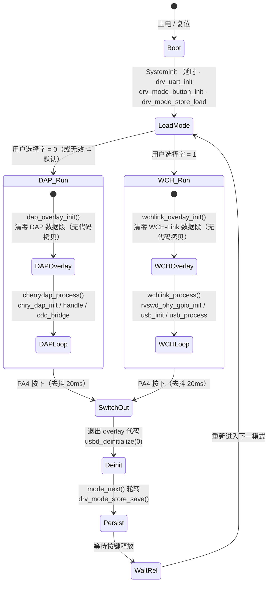

## 8. 双模式运行期状态机

两种模式都要占用 `PA2=SWCLK/DCK`、`PA3=SWDIO/DIO`，且 USB 身份不同，
**不可能同时运行**。切换 = 交出 USB → 用另一套描述符重新枚举。

关键约束（改代码时必须遵守）：

- 数据段的清零**只能由 `main()` 完成**，不能放进 `cherrydap_process()` / `wchlink_process()`
  ——那两个函数自身就在被覆盖的地址范围内，调用即跳进未初始化的地址。
- 覆盖数据段 RAM 之前，必须确认已不在执行那段地址里的代码（先返回 `main()`）。
- 新增模式：在 `firmware_mode_t` 末尾**追加**成员 + 在 `mode_run()` 加一个 `case`
  （已有取值写进 Flash，属 ABI，不可重排；取值须从 0 起连续）。
