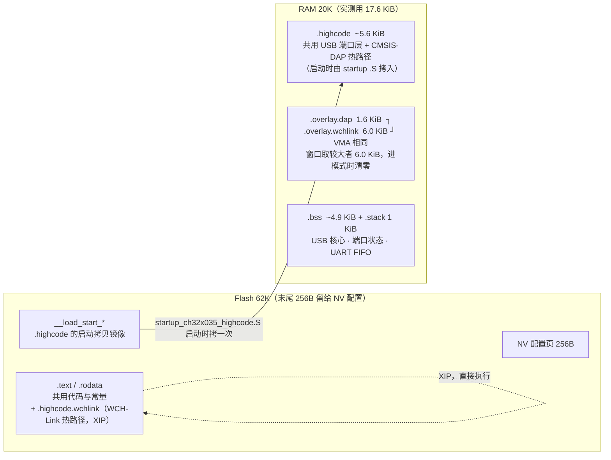

## 9. 内存布局与 RAM overlay

两套代码全编时 Flash 够（~59 KiB / 63232 B），RAM 曾需 ~25.3 KiB 而只有 20 KiB。
解决办法：把**只有一个模式用得到**的私有**数据**放进同一段 RAM 地址（ld `OVERLAY`）。
代码不需要运行期拷贝 —— DAP 热路径并进常驻 `.highcode`（启动时拷一次），
WCH-Link 热路径直接跑在 Flash 上（XIP）。

| 段 | 归属 | 属性宏（`src/mode_overlay.h`） | 位置 |
| --- | --- | --- | --- |
| `.highcode` | 共用 | `__attribute__((section(".highcode")))` | RAM（启动拷入）|
| `.highcode.dap` | 仅 CMSIS-DAP | `DAP_HIGHCODE_SECTION` | RAM（并进 `.highcode`）|
| `.overlay.dap` | 仅 CMSIS-DAP | `DAP_PRIVATE_SECTION` | RAM，overlay |
| `.highcode.wchlink` | 仅 WCH-Link | `WCHLINK_HIGHCODE_SECTION` | **Flash（XIP）** |
| `.overlay.wchlink` | 仅 WCH-Link | `WCHLINK_PRIVATE_SECTION` | RAM，overlay |

> 往某模式新加较大静态**数据**时，若要参与复用，需显式加 `DAP_PRIVATE_SECTION` /
> `WCHLINK_PRIVATE_SECTION`。
>
> ⚠️ WCH-Link 热路径在 Flash 上执行，48 MHz 下每次取指多 **2 个等待周期**
> （`FLASH_ACTLR_LATENCY_2`），RVSWD 时钟比放 RAM 时低 —— 这是为省掉运行期代码
> 拷贝而做的取舍。
>
> ⚠️ 不要把 `.text.DAP_ProcessCommand`（约 2.9 KiB）收进 `.highcode`：会让 RAM 到
> 20.5 KiB（超上限）且 `.bss` 压到 `.stack` 上。

---

各段实测大小：

| 段 | 内容 | 实测大小 | 位置 |
| --- | --- | --- | --- |
| `.highcode` | **共用**：USB 端口层热路径 | 约 3.1 KiB | RAM（启动时拷入）|
| `.highcode.dap` | 仅 CMSIS-DAP：`sw_dp.c`/`dap_main.c` 热路径 | 约 2.4 KiB | RAM（并进 `.highcode`）|
| `.overlay.dap` | 仅 CMSIS-DAP：USB 收发缓冲 | 约 1.6 KiB | RAM，overlay |
| `.text` 里的 `.highcode.wchlink` | 仅 WCH-Link：`rvswd_phy_gpio.c` 位翻转 | 约 2.0 KiB | **Flash（XIP）** |
| `.overlay.wchlink` | 仅 WCH-Link：会话/传输状态与大缓冲 | 约 6.0 KiB | RAM，overlay |
| `.bss` | 共用：USB 核心、端口状态、UART FIFO 等 | 约 4.9 KiB | RAM |

**只有数据还参与 overlay**：两个数据段的 VMA **相同**（取较大的 6.0 KiB 作窗口），
因为数据不能放 Flash（要写），而两模式的数据又互斥 —— 重叠才省 RAM。

注意事项（改代码时要留意）：

- 数据段的清零**必须由 `main()` 完成**，不能放进 `cherrydap_process()` 之类的
  函数里 —— 那个函数自己就在被覆盖的地址范围内，调用即等于跳进未初始化的地址。
- 模式退出时先返回 `main()`（并在那里 `usbd_deinitialize`），确认不再执行该段里的
  代码后，才允许覆盖那段 RAM。
- 往任一模式里新加**较大的静态缓冲**时，如果想让它也参与复用，需要给它加上
  `DAP_PRIVATE_SECTION` / `WCHLINK_PRIVATE_SECTION`（见 `src/mode_overlay.h`）。
  不加也能工作，只是不省 RAM。
- `.highcode` 里新增共用热路径代码会同时占用两种模式的 RAM（这是应该的 —— 它被共用）。
- **不要把 `.text.DAP_ProcessCommand`（约 2.9 KiB）收进 `.highcode`**：它的名字会被
  `.text` 的 `*(.text.*)` 收走而留在 Flash。收进 RAM 会把 RAM 顶到 20.5 KiB
  （> 20 KiB 上限），并且 `.bss` 会压到 `.stack` 上。
