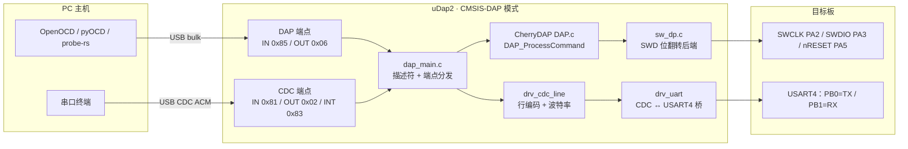

## 10. 模式一：CMSIS-DAP 数据通路

USB 身份：`0d28:0204`（WinUSB，MS OS 2.0 描述符自动匹配），同时提供一个 CDC 串口。

- 主循环：`chry_dap_handle()`（推进 DAP 收发）+ `chry_dap_cdc_bridge()`（推进串口桥）。
- CDC OUT 方向做**背压**：`drv_uart_tx_free()` 余量足够才重挂端点，USB bulk OUT 天然流控，
  主机 `write()` 自然阻塞在波特率上，不丢字节。
- SWD 快/慢路径阈值由 `DELAY_FAST_CYCLES` 决定（阈值 = `24MHz / (2 + DELAY_FAST_CYCLES)`，
  本工程 = 2 → 6 MHz）。
