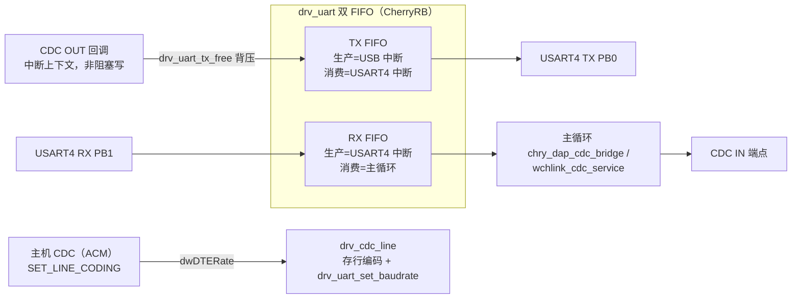

## 11. CDC ↔ USART4 串口桥（两模式共用）

- **背压**：OUT 回调重挂端点前先查 `drv_uart_tx_free()`；余量不足就不重挂，主机收到 NAK 自然阻塞。
- `usbd_ep_start_write` **非中断安全**，故 IN 方向（UART RX → CDC IN）必须在主循环推进。
- 测量统计：`drv_uart_rx_overflow_count()` / `drv_uart_tx_overflow_count()`，正常收发下
  `tx_overflow` 应恒为 0（否则说明背压失效）。
