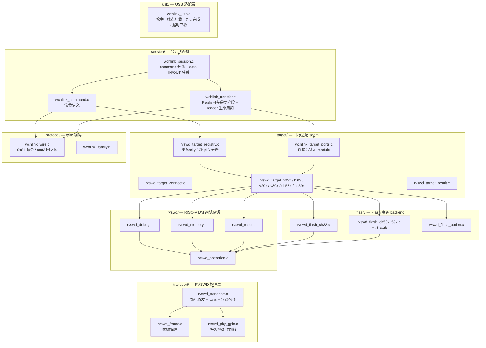
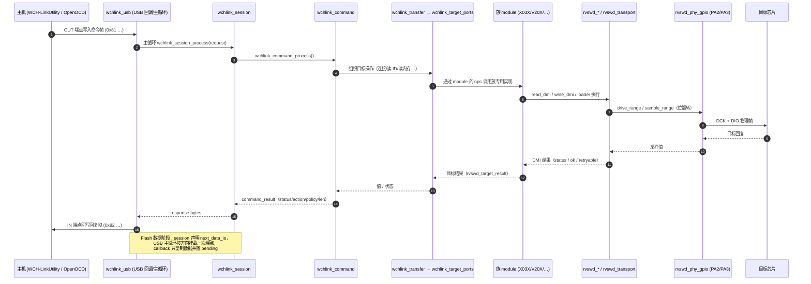
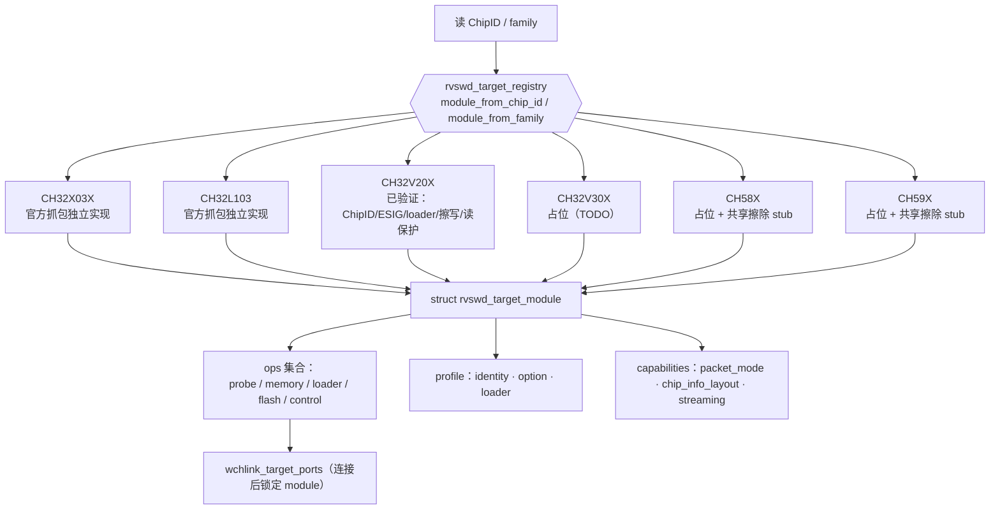

## 12. 模式二：WCH-Link

### 12.1 分层与依赖方向

USB 身份：`1a86:8010`（厂商接口 + CDC），序列号 = `"035"` + UID 前 9 位十六进制。
依赖从 `usb` 进入 `session`，再进入 `target` / `rvswd` / `transport`，**底层不反向依赖上层**。

各层职责（详见各目录 `README.md`）：

| 层 | 职责 | 不做 |
| --- | --- | --- |
| `usb/` | 枚举、端点挂载、异步完成标志、超时回收、主循环调度 | 不解释命令字段，不调 target/rvswd/flash |
| `session/` | 把 wire command 组织成有序目标操作，映射错误 | 不实现物理传输 |
| `target/` | 目标身份、ChipID→module 解析、target ports、loader 契约、族专用行为 | 不让 backend 反向识别族 |
| `rvswd/` | DM 调试原语（寄存器/内存/复位），失败诊断按次调用保存 | — |
| `transport/` | 帧编解码、GPIO 物理收发、DMI 传输、时钟/方向/重试 | 不保存芯片 Flash 参数 |
| `flash/` | 无族选择的 Flash 事务 backend 与共享擦除 stub | 不按 family 选 backend |
| `protocol/` | WCH-Link USB 命令帧（0x81 命令 / 0x82 回复） | — |

---

### 12.2 命令处理时序

USB 回调只更新端点状态，完整 command/data 阶段由**主循环**交给 session 处理。

- `WCHLINK_FAMILY_DEVICE_MODE = 0x0f`：`0x02 Query` 恒回“RISC-V 模式”；`0x01 IAP` 不回复，
  改为 `bsp_system_enter_isp()` 复位进 ISP bootloader（官方工具“切换模式”的入口）。
- 厂商接口会在同一端点上传 256 B 多包（4×64 B），依赖 DATA0/DATA1 toggle 同步；
  实测无 toggle 失配，故本工程未改端口层时序。

---

### 12.3 目标芯片族分派

`registry` 只做索引/分派，族差异集中在各 `rvswd_target_xxx.c`；profile 只存稳定数据与能力，
寄存器访问顺序、前置配置、错误恢复、loader 时序由族模块的 C 函数实现。

`struct rvswd_target_module`（`src/wchlink/target/rvswd_target_module.h`）把
**行为**（ops 函数指针）与**数据**（profile / capabilities）分开：USB、transport、
通用 RVSWD 只依赖中立类型与原语，不读取族模块的私有数据。
