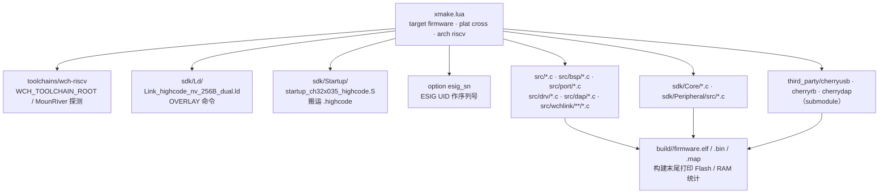

## 13. 构建与模块依赖



- **唯一构建**：无 `--dap` / `--wchlink` 裁剪选项，编译即双模式；`--esig_sn` 是唯一应用侧选项。
- 必选项（缺文件直接报错）：`src/usb_config.h`、CherryUSB 核心+CDC、`src/port/usb_ch32x035_dc_usbfs.c`、
  `src/bsp/bsp_usb.c`。
- 必须 `-Os`（debug 也是 `-Os`+LTO）：`-O3`+LTO 会把 USB 调用链内联进中断处理，
  `.highcode` 从 5.4 KiB 膨胀到 18.5 KiB，链接直接失败。
- 实测尺寸：默认 58.53 KiB Flash / 17.23 KiB RAM；`--esig_sn=y` 58.67 KiB / 17.23 KiB。

---

### 13.1 USB 端口层（必选）

本芯片必然使用 USB，所以以下三部分在 `xmake.lua` 中**无条件编译**，缺文件直接报错
（`USB is mandatory: missing ...`），不会默默编出一个没有 USB 的固件：

| 部分 | 位置 |
| --- | --- |
| CherryUSB 初始化配置 | `src/usb_config.h` |
| CherryUSB 核心 + CDC ACM 类 | `third_party/cherryusb/`（submodule） |
| CH32X035 USBFS 设备端口 glue | `src/port/usb_ch32x035_dc_usbfs.c` |
| CH32X035 USB 硬件初始化 | `src/bsp/bsp_usb.c` |

注意：CherryUSB 的端口层把 `usb_dc_low_level_init()` / `usb_dc_low_level_deinit()` 声明为
`__WEAK` 空实现，**USB 时钟、PC16/PC17、AFIO PHY、NVIC 必须由应用侧提供**，否则
`usbd_initialize()` 之后 USB 既不枚举也不进中断。`src/bsp/bsp_usb.c` 覆盖了这两个弱函数，
并按 WCH 官方例程区分供电电压：

- 5V 供电：关闭 `PHY_V33`，UDP 内部上拉 10K；
- 3.3V 供电：使能 `PHY_V33`，UDP 内部上拉 1.5K（USB 2.0 全速规范要求）。

调用链是 `usbd_initialize()` → `usb_dc_init()` → `usb_dc_low_level_init()`，因此应用侧必须先
调用 `NVIC_PriorityGroupConfig()` 设定优先级分组。

### 13.2 构建命令

需要 WCH RISC-V GCC 工具链：设置 `WCH_TOOLCHAIN_ROOT`，或安装 MounRiver Studio 2
由 `toolchains/wch-riscv/xmake.lua` 自动探测默认路径。

```powershell
# 便捷脚本（release）。产物固定是 CMSIS-DAP + WCH-Link 双模式固件
.\build.ps1
.\build.ps1 -EsigSn n       # 退回固定串 DEADBEEF（默认：芯片 ESIG UID，每颗唯一）
.\build.ps1 -Clean          # 先清理
.\build.ps1 -Mode debug     # debug 构建
.\build.ps1 -Reconfigure    # 工具链路径变化后强制重新配置

# 或直接用 xmake
$env:WCH_TOOLCHAIN_ROOT = "C:/MounRiver/MounRiver_Studio2/resources/app/resources/win32/components/WCH/Toolchain/RISC-V Embedded GCC12"
xmake f -m release -y
xmake -r

# 用固定串 DEADBEEF 作序列号（xmake 默认也是 esig_sn）
xmake f -m release --esig_sn=n -y
xmake -r
```

> ⚠️ `--esig_sn` 是唯一的应用侧选项，xmake 会把它**持久化**到本地配置；
> `build.ps1` 每次都显式传值，保证构建结果只由参数决定。直接敲 xmake 时也请显式指明。
> 调试器功能的裁剪选项（`--dap` / `--wchlink`）已经**删除** —— 传了 xmake 会报
> `error: Invalid option: --dap=n`，因为不存在「只编一个模式」的构建。

产物：`build/<mode>/firmware.elf`、`firmware.bin`、`firmware.map`。构建结束会打印
Flash / RAM 占用统计。

链接脚本为 `sdk/Ld/Link_highcode_nv_256B_dual.ld`：Flash 62K（末尾 256B 留给 NV 配置），
RAM 20K；`.highcode` 段由 `startup_ch32x035_highcode.S` 在启动时从 Flash 搬到 RAM 执行，
USB 设备端口等热路径代码通过 `section(".highcode")` 放在其中。

### 13.3 双模式尺寸与编译选项

`xmake.lua` **不提供裁剪选项**：CMSIS-DAP（CherryDAP + `src/dap`、`src/drv` glue）与
WCH-Link（`src/wchlink/`，RVSWD 目标调试 / Flash 烧录）两套代码强制同时编入，
产出的一律是运行期按键切换的双模式固件。两者都要占用 PA2=SWCLK / PA3=SWDIO，
USB 身份也不同（见「双模式：模式切换按键与持久化」一节），所以不存在「只编其中一个」的构建。

`src/main.c` 在两种模式间轮转；两种模式**各自私有**的代码与数据被链接到同一段
RAM（overlay），这是两套代码能同时装进 20 KiB RAM 的原因。

实测尺寸（release）：

| 配置 | Flash | RAM |
| --- | --- | --- |
| 默认（`-EsigSn y`，序列号用芯片 ESIG UID） | 58.67 KiB | 17.23 KiB |
| `-EsigSn n`（序列号固定 `DEADBEEF`） | 58.53 KiB | 17.23 KiB |

上限：Flash 63232 B（`62K - 256`，末尾 256 B 留给 NV 配置），RAM 20480 B。
Flash 余量约 3.2 KiB，RAM 余量约 2.8 KiB。

构建开始时会校验两套模式的关键文件（`src/dap/DAP_config.h`、`dap_main.c`、`sw_dp.c`、
`src/wchlink/` 的若干文件、`drv_mode_button.c` 等）是否齐全，缺文件直接报错，
不会默默编出一个少了一半功能的固件。

> **必须用 `-Os`**，这是能装进 62 KiB / 20 KiB 的前提。
> `sdk/Ld/Link_highcode_nv_256B_dual.ld` 的 `.highcode` 是 `> RAM AT > FLASH`（启动时
> 从 Flash 搬到 RAM 执行），而 USB 端口层把 `usbd_ep_start_read/write` 与
> `USBFS_IRQHandler` 放进了 `.highcode`。用 `-O3` + LTO 时整条 USB 调用链会被内联进
> 中断处理函数，`.highcode` 从 5.4 KiB 膨胀到 18.5 KiB，同时吃光 Flash（溢出
> 11100 字节）和 RAM（溢出约 10.6 KiB）—— 实测链接直接失败。参考工程
> `ch32x035-usb-wchlink-main` 同样使用 smallest。
>
> **debug 模式（`-Mode debug`）同样是 `-Os` + LTO**：`-Og` / `-O0` 下两套代码 +
> overlay 装不进 Flash（`.data` 直接报 region overflow），所以 debug 只额外保留调试
> 符号，不降优化。

链接脚本的 `OVERLAY` 段 LMA 由 ld 单独排布，**不受 `FLASH` 区域长度约束**，超出也不会
报链接错误，只会静默生成一个装不进芯片的 `.bin`。因此 `xmake.lua` 在 `after_build`
里按 `.bin` 实际长度兜底检查，超过 63232 B 直接报错并终止构建。
