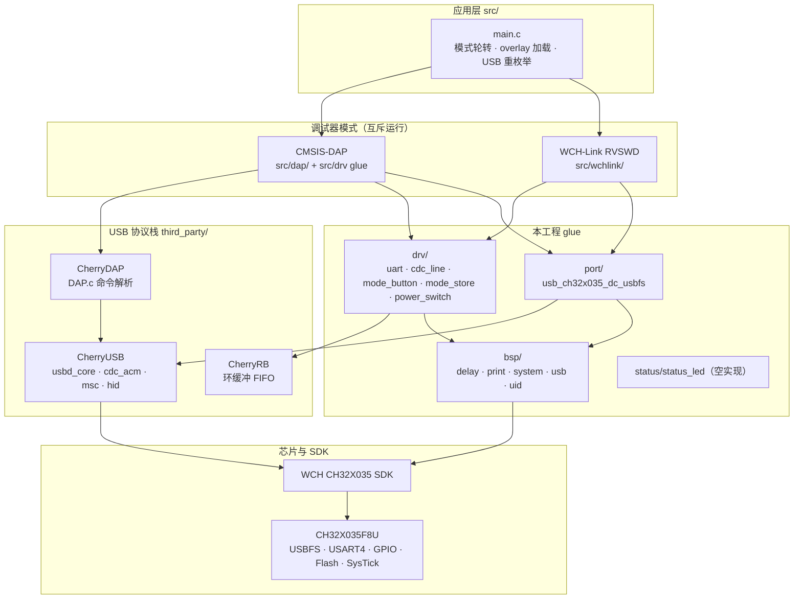
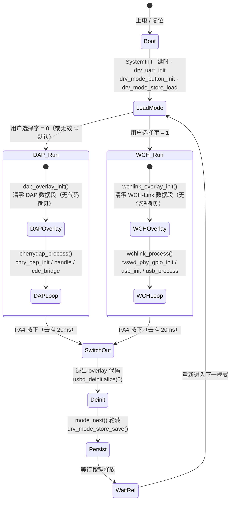
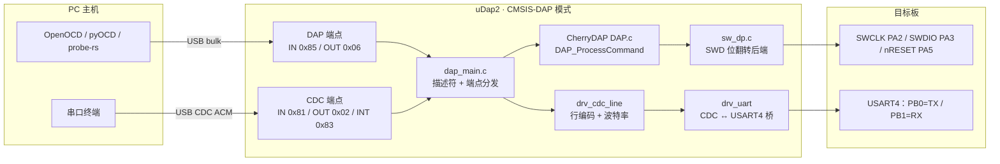
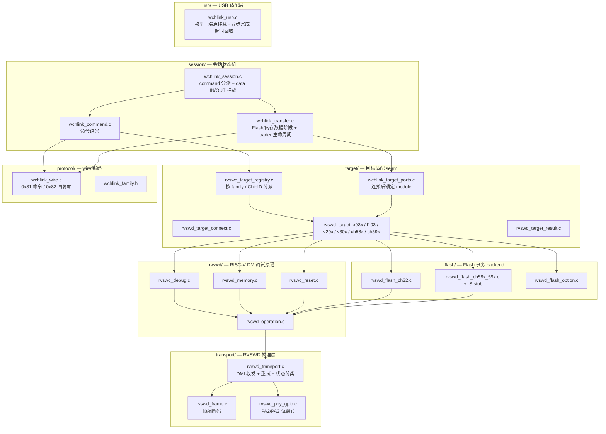
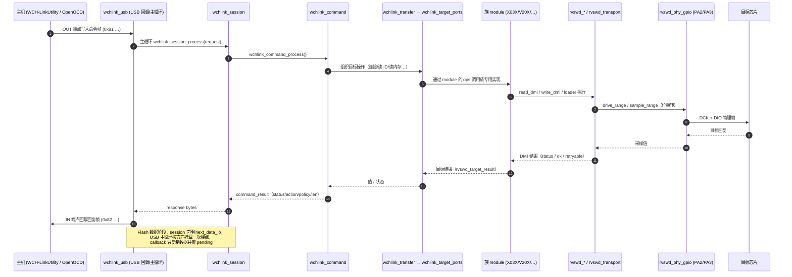
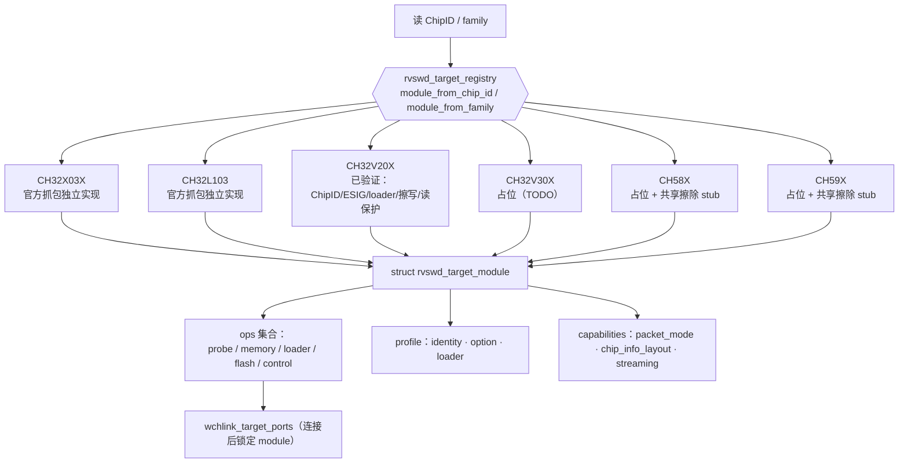
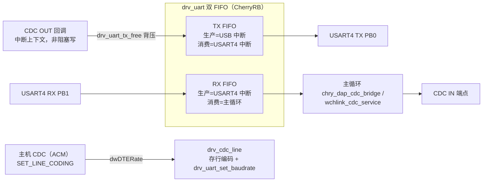
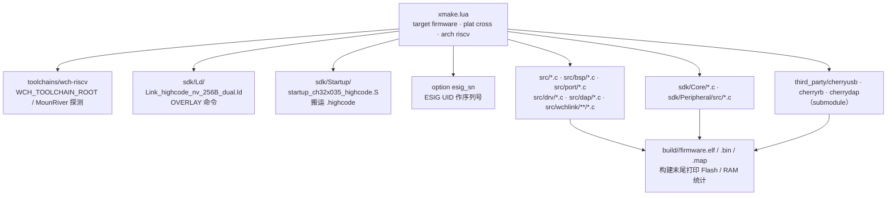

# uDap 固件代码结构分析

> 本文用 Mermaid 图梳理 `firmware/`（xmake 工程根）的代码结构。事实依据为
> `firmware/xmake.lua`、`firmware/src/**`、`firmware/README.md` 与
> `sdk/Ld/Link_highcode_nv_256B_dual.ld`。
>
> 一句话概括：**CH32X035F8U（RISC-V）上的双模式调试器固件**——CMSIS-DAP 与
> WCH-Link（RVSWD）两套代码编进同一份固件，运行期用 PA4 按键互斥切换，两份
> 私有代码/数据通过 RAM overlay 复用同一段地址；CDC↔USART4 串口桥在两种模式下行为一致。

---

## 1. 仓库结构

```text
uDap/
├── firmware/                    xmake 工程根
│   ├── src/                     本工程代码（应用 + 移植 glue）
│   │   ├── main.c               入口：双模式轮转 / overlay 初始化 / USB 重枚举
│   │   ├── mode_overlay.h       overlay 段属性宏（.highcode.dap / .overlay.wchlink …）
│   │   ├── system_ch32x035.c    时钟与系统初始化
│   │   ├── ch32x035_it.c        中断向量实现
│   │   ├── usb_config.h         CherryUSB 应用侧配置（必选）
│   │   ├── bsp/                 板级：延时/打印/系统复位/USB 硬件/UID
│   │   ├── port/                CherryUSB CH32X035 USBFS 设备端口 glue（必选）
│   │   ├── dap/                 CMSIS-DAP glue（描述符 + SWD 位翻转）
│   │   ├── wchlink/             WCH-Link glue（transport/protocol/rvswd/target/flash/session/usb）
│   │   ├── status/              状态灯接口（本板空实现）
│   │   └── drv/                 UART 桥 / 模式按键 / 模式持久化 / 电源开关（空实现）
│   ├── sdk/                     WCH CH32X035 SDK（Core/Peripheral/Startup/Ld）
│   ├── third_party/             仅上游 submodule：cherryusb / cherryrb / cherrydap
│   ├── toolchains/wch-riscv/    工具链探测
│   ├── docs/                    性能与结构文档（含本文件）
│   ├── tools/                   测速 / 串口压力测试脚本（Python + PowerShell + Tcl）
│   ├── xmake.lua                构建脚本（唯一构建：双模式）
│   └── build.ps1                便捷构建脚本
├── hardware/                    KiCad 工程（uDap.kicad_sch / .kicad_pcb）+ ch552 变体
└── software/                    上位机等（当前为空）
```

---

## 2. 整体分层架构



**依赖方向**：`main` → 模式 → glue → 协议栈/SDK。WCH-Link 内部还有严格的分层
（见第 6 节），底层模块不反向依赖上层命令。

---

## 3. 双模式运行期状态机

两种模式都要占用 `PA2=SWCLK/DCK`、`PA3=SWDIO/DIO`，且 USB 身份不同，
**不可能同时运行**。切换 = 交出 USB → 用另一套描述符重新枚举。



关键约束（改代码时必须遵守）：

- 数据段的清零**只能由 `main()` 完成**，不能放进 `cherrydap_process()` / `wchlink_process()`
  ——那两个函数自身就在被覆盖的地址范围内，调用即跳进未初始化的地址。
- 覆盖数据段 RAM 之前，必须确认已不在执行那段地址里的代码（先返回 `main()`）。
- 新增模式：在 `firmware_mode_t` 末尾**追加**成员 + 在 `mode_run()` 加一个 `case`
  （已有取值写进 Flash，属 ABI，不可重排；取值须从 0 起连续）。

---

## 4. 内存布局与 RAM overlay

两套代码全编时 Flash 够（~59 KiB / 63232 B），RAM 曾需 ~25.3 KiB 而只有 20 KiB。
解决办法：把**只有一个模式用得到**的私有**数据**放进同一段 RAM 地址（ld `OVERLAY`）。
代码不需要运行期拷贝 —— DAP 热路径并进常驻 `.highcode`（启动时拷一次），
WCH-Link 热路径直接跑在 Flash 上（XIP）。

```mermaid
flowchart LR
    subgraph FLASH["Flash 62K（末尾 256B 留给 NV 配置）"]
        direction TB
        F_TEXT[".text / .rodata<br/>共用代码与常量<br/>+ .highcode.wchlink（WCH-Link 热路径，XIP）"]
        F_HC["__load_start_*<br/>.highcode 的启动拷贝镜像"]
        F_NV["NV 配置页 256B"]
    end

    subgraph RAM["RAM 20K（实测用 17.6 KiB）"]
        direction TB
        R_HC[".highcode  ~5.6 KiB<br/>共用 USB 端口层 + CMSIS-DAP 热路径<br/>（启动时由 startup .S 拷入）"]
        R_OV[".overlay.dap  1.6 KiB  ┐<br/>.overlay.wchlink  6.0 KiB ┘ VMA 相同<br/>窗口取较大者 6.0 KiB，进模式时清零"]
        R_BSS[".bss  ~4.9 KiB + .stack 1 KiB<br/>USB 核心 · 端口状态 · UART FIFO"]
    end

    F_HC -->|startup_ch32x035_highcode.S 启动时拷一次| R_HC
    F_TEXT -.->|XIP，直接执行| F_TEXT
```



| 段 | 归属 | 属性宏（`src/mode_overlay.h`） | 位置 |
| --- | --- | --- | --- |
| `.highcode` | 共用 | `__attribute__((section(".highcode")))` | RAM（启动拷入）|
| `.highcode.dap` | 仅 CMSIS-DAP | `DAP_HIGHCODE_SECTION` | RAM（并进 `.highcode`）|
| `.overlay.dap` | 仅 CMSIS-DAP | `DAP_PRIVATE_SECTION` | RAM，overlay |
| `.highcode.wchlink` | 仅 WCH-Link | `WCHLINK_HIGHCODE_SECTION` | **Flash（XIP）** |
| `.overlay.wchlink` | 仅 WCH-Link | `WCHLINK_PRIVATE_SECTION` | RAM，overlay |

> 往某模式新加较大静态**数据**时，若要参与复用，需显式加 `DAP_PRIVATE_SECTION` /
> `WCHLINK_PRIVATE_SECTION`。
>
> ⚠️ WCH-Link 热路径在 Flash 上执行，48 MHz 下每次取指多 **2 个等待周期**
> （`FLASH_ACTLR_LATENCY_2`），RVSWD 时钟比放 RAM 时低 —— 这是为省掉运行期代码
> 拷贝而做的取舍。
>
> ⚠️ 不要把 `.text.DAP_ProcessCommand`（约 2.9 KiB）收进 `.highcode`：会让 RAM 到
> 20.5 KiB（超上限）且 `.bss` 压到 `.stack` 上。

---

## 5. 模式一：CMSIS-DAP 数据通路

USB 身份：`0d28:0204`（WinUSB，MS OS 2.0 描述符自动匹配），同时提供一个 CDC 串口。



- 主循环：`chry_dap_handle()`（推进 DAP 收发）+ `chry_dap_cdc_bridge()`（推进串口桥）。
- CDC OUT 方向做**背压**：`drv_uart_tx_free()` 余量足够才重挂端点，USB bulk OUT 天然流控，
  主机 `write()` 自然阻塞在波特率上，不丢字节。
- SWD 快/慢路径阈值由 `DELAY_FAST_CYCLES` 决定（阈值 = `24MHz / (2 + DELAY_FAST_CYCLES)`，
  本工程 = 2 → 6 MHz）。

---

## 6. 模式二：WCH-Link 分层与依赖方向

USB 身份：`1a86:8010`（厂商接口 + CDC），序列号 = `"035"` + UID 前 9 位十六进制。
依赖从 `usb` 进入 `session`，再进入 `target` / `rvswd` / `transport`，**底层不反向依赖上层**。



各层职责（详见各目录 `README.md`）：

| 层 | 职责 | 不做 |
| --- | --- | --- |
| `usb/` | 枚举、端点挂载、异步完成标志、超时回收、主循环调度 | 不解释命令字段，不调 target/rvswd/flash |
| `session/` | 把 wire command 组织成有序目标操作，映射错误 | 不实现物理传输 |
| `target/` | 目标身份、ChipID→module 解析、target ports、loader 契约、族专用行为 | 不让 backend 反向识别族 |
| `rvswd/` | DM 调试原语（寄存器/内存/复位），失败诊断按次调用保存 | — |
| `transport/` | 帧编解码、GPIO 物理收发、DMI 传输、时钟/方向/重试 | 不保存芯片 Flash 参数 |
| `flash/` | 无族选择的 Flash 事务 backend 与共享擦除 stub | 不按 family 选 backend |
| `protocol/` | WCH-Link USB 命令帧（0x81 命令 / 0x82 回复） | — |

---

## 7. WCH-Link 命令处理时序

USB 回调只更新端点状态，完整 command/data 阶段由**主循环**交给 session 处理。



- `WCHLINK_FAMILY_DEVICE_MODE = 0x0f`：`0x02 Query` 恒回“RISC-V 模式”；`0x01 IAP` 不回复，
  改为 `bsp_system_enter_isp()` 复位进 ISP bootloader（官方工具“切换模式”的入口）。
- 厂商接口会在同一端点上传 256 B 多包（4×64 B），依赖 DATA0/DATA1 toggle 同步；
  实测无 toggle 失配，故本工程未改端口层时序。

---

## 8. 目标芯片族分派

`registry` 只做索引/分派，族差异集中在各 `rvswd_target_xxx.c`；profile 只存稳定数据与能力，
寄存器访问顺序、前置配置、错误恢复、loader 时序由族模块的 C 函数实现。



`struct rvswd_target_module`（`src/wchlink/target/rvswd_target_module.h`）把
**行为**（ops 函数指针）与**数据**（profile / capabilities）分开：USB、transport、
通用 RVSWD 只依赖中立类型与原语，不读取族模块的私有数据。

---

## 9. CDC ↔ USART4 串口桥（两模式共用）



- **背压**：OUT 回调重挂端点前先查 `drv_uart_tx_free()`；余量不足就不重挂，主机收到 NAK 自然阻塞。
- `usbd_ep_start_write` **非中断安全**，故 IN 方向（UART RX → CDC IN）必须在主循环推进。
- 测量统计：`drv_uart_rx_overflow_count()` / `drv_uart_tx_overflow_count()`，正常收发下
  `tx_overflow` 应恒为 0（否则说明背压失效）。

---

## 10. 构建与模块依赖（xmake）



- **唯一构建**：无 `--dap` / `--wchlink` 裁剪选项，编译即双模式；`--esig_sn` 是唯一应用侧选项。
- 必选项（缺文件直接报错）：`src/usb_config.h`、CherryUSB 核心+CDC、`src/port/usb_ch32x035_dc_usbfs.c`、
  `src/bsp/bsp_usb.c`。
- 必须 `-Os`（debug 也是 `-Os`+LTO）：`-O3`+LTO 会把 USB 调用链内联进中断处理，
  `.highcode` 从 5.4 KiB 膨胀到 18.5 KiB，链接直接失败。
- 实测尺寸：默认 58.53 KiB Flash / 17.23 KiB RAM；`--esig_sn=y` 58.67 KiB / 17.23 KiB。

---

## 11. 引脚分配总表

| 信号 | 引脚 | 使用方 | 备注 |
| --- | --- | --- | --- |
| SWCLK / DCK | PA2 | CMSIS-DAP + WCH-Link（互斥） | 两模式共用 |
| SWDIO / DIO | PA3 | CMSIS-DAP + WCH-Link（互斥） | 两模式共用 |
| nRESET | PA5 | 仅 CMSIS-DAP | 待按原理图核对 |
| 桥接串口 | PB0=TX / PB1=RX | USART4（两模式一致） | 网络名 `PB0_USART4_TX` / `PB1_USART4_RX` |
| 状态灯 | PB12 | 仅 CMSIS-DAP（`LED_CONNECTED_OUT`） | 高电平点亮；WCH-Link 不驱动 |
| 模式按键 | PA4 | 双模式 | 外接，一端 PA4 一端 GND，内部上拉 |
| USB | PC16=UDM / PC17=UDP | 两模式 | 固定复用 |
