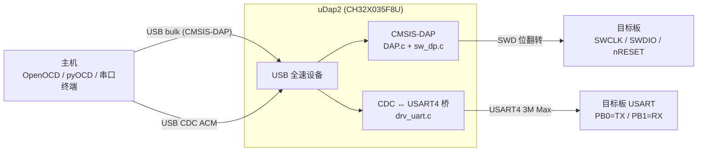
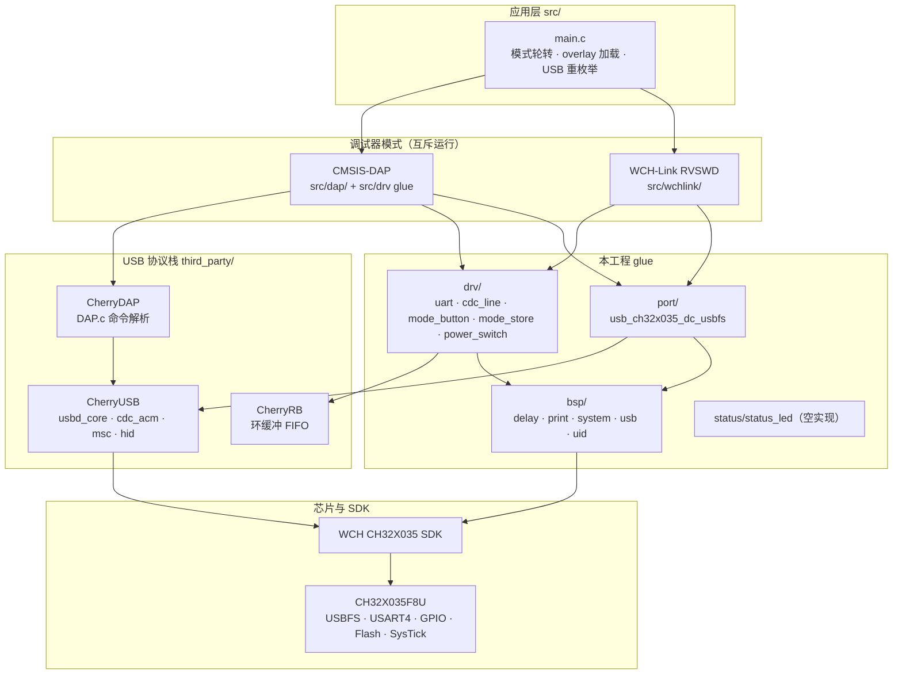
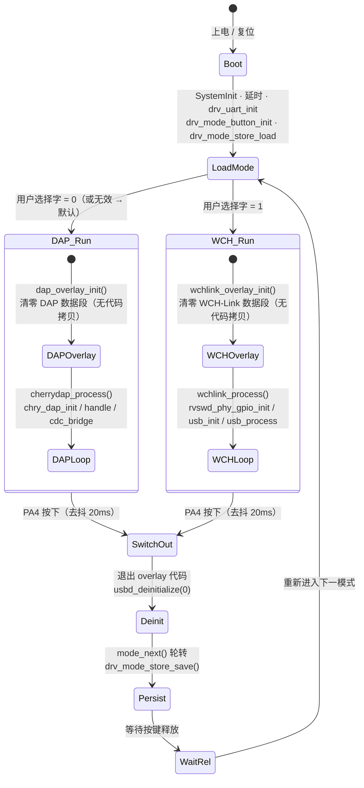
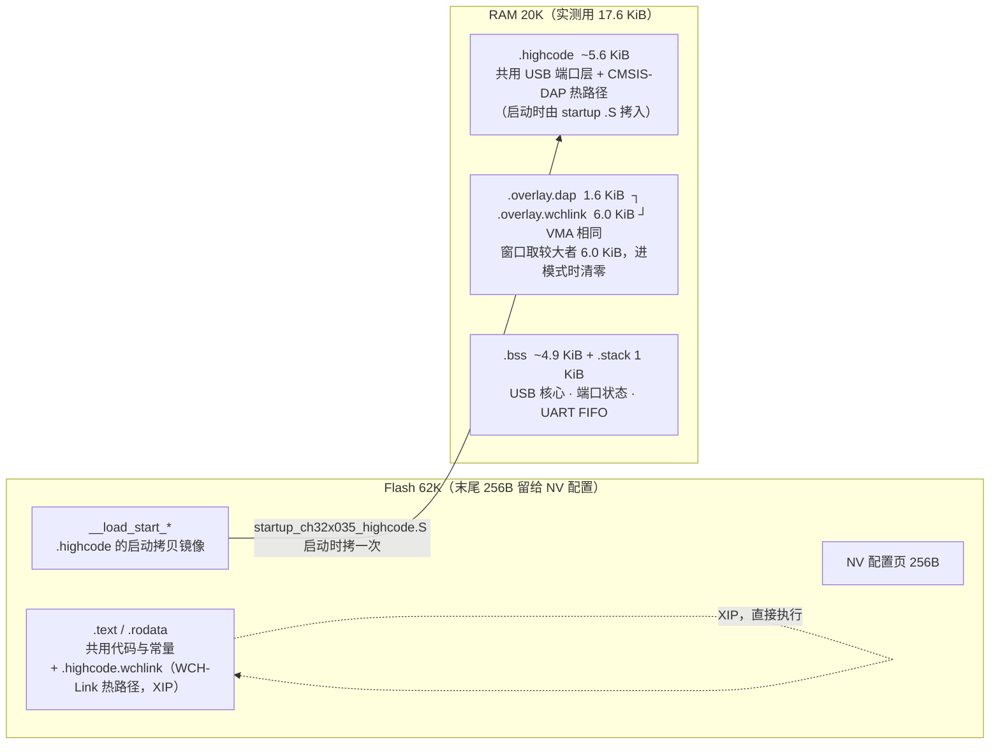
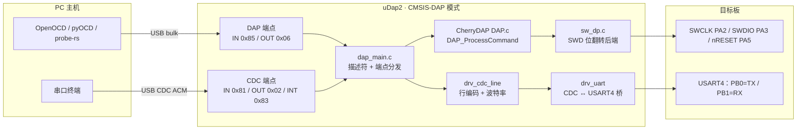
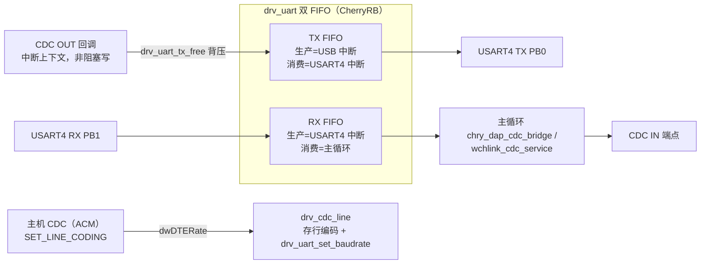
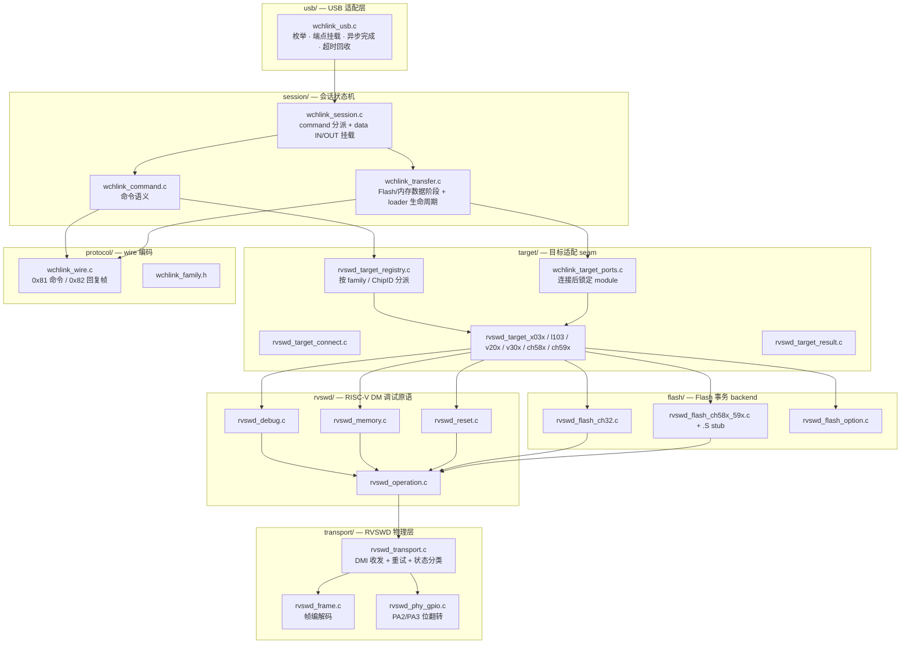
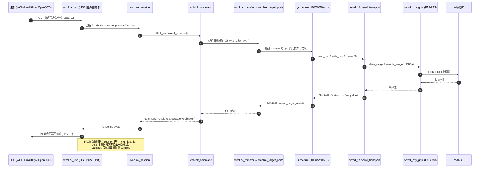
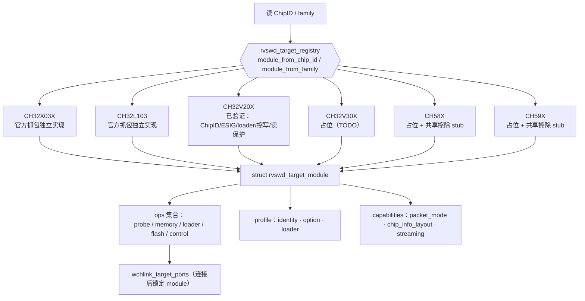
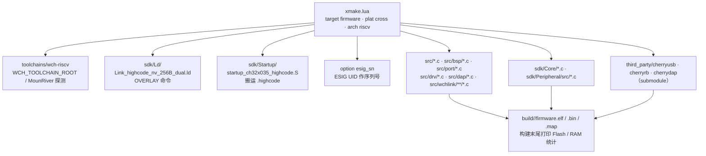

# uDap

基于 **CH32X035F8U** 的 **CMSIS-DAP 调试器 + WCH-Link 调试器 + USB↔串口桥**。
单颗 USB 全速设备口同时提供 SWD 调试和一路虚拟串口；仓库包含固件（`firmware/`）、
KiCad 硬件设计（`hardware/`）与上位机脚本（`software/`）。

本文件是**唯一的项目文档**：架构、内存布局、双模式行为、性能实测、已知限制都在这。

> ⚠️ **本文件由 `doc/` 下的分节文档合并生成**（`python doc/build_readme.py`）。
> 要改内容请改 `doc/` 下的对应小节，**不要直接改这里** —— 下次合并会覆盖。
> 参与合并的文件、命名与编辑约定见 [`doc/README.md`](doc/README.md)。

- 调试器 ①：**CMSIS-DAP**（bulk，WinUSB）——OpenOCD / pyOCD / probe-rs 可直接使用
- 调试器 ②：**WCH-Link**（RVSWD，`1a86:8010`）——支持 CH32X03X / CH32L10X / CH32V20X /
  CH32V30X / CH58X / CH59X 六个目标族
- 两个调试器**同编入一份固件**（无裁剪选项），运行期按键（PA4 接 GND）切换，见「双模式：模式切换按键与持久化」
- 桥接串口：CDC ACM ↔ 目标板 USART4（PB0=TX / PB1=RX），**不限制波特率**
- SWD 时钟：请求 **≥6 MHz** 自动切「快路径」，**6 MHz 与更高同速**，推荐就填 6 MHz
- SWD 吞吐（STM32F411 目标，64 KiB 块）：**pyocd 262 写 / 232 读 KiB/s**、
  OpenOCD 149 / 148、probe-rs 155 / 140 —— 见「性能实测」一节
- 串口环回：**2 Mbaud 持续满载零丢字节**（96~98 % 利用率）；分块发送时 6 Mbaud 亦字节无误
- 桥接吞吐天花板：约 **190~200 KiB/s**（≈2 Mbaud），受 USB IN 侧调度限制，与 USB 带宽无关

---

[TOC]

---

# 第一部分：概览

## 1. 这是什么

一块 RISC-V MCU 做成的「调试器小板」：插上 USB 后主机看到**一个 CMSIS-DAP 探针**和
**一个串口**，两者共用同一颗芯片、同一根 USB 线。它替代的是「J-Link/DAPLink + 独立 USB-TTL」
两件套，用于嵌入式目标板的调试与串口日志。

数据通路：



---

## 2. 硬件

### 主控芯片

| 项目 | 参数 |
| --- | --- |
| 型号 | **CH32X035F8U6**（沁恒 WCH，TSSOP-20） |
| 内核 | RISC-V，`rv32imacxw`（RV32IMAC + WCH 扩展，沁恒 QingKe V4 系列） |
| 主频 | 48 MHz，来自内部 HSI RC（无外部晶振），工程内 `CPU_CLOCK = 48000000` |
| Flash | 62 KiB 可用（链接脚本按「62K − 256B」划分，末尾 256B 留给 NV 配置） |
| SRAM | 20 KiB |
| USB | 内置 USB 全速（12 Mbps）设备控制器，DP/DM 固定在 PC16/PC17 |
| 固件体积 | Flash ≈ 59.8 KiB（`.bin` 61244 B）、RAM ≈ 18.5 KiB（release，`-EsigSn y`；`.bin` 上限 63232 B） |

芯片外设在本工程中用到的部分：USBFS、USART4、GPIOA/GPIOB（含 BSHR/BCR 原子置位复位，
SWD 位翻转靠它做到单指令翻转）、SysTick、Flash。

| 信号 | 引脚 | 说明 |
| --- | --- | --- |
| SWCLK | PA2 | SWD 时钟 |
| SWDIO | PA3 | SWD 双向数据（CFGLR 动态切输入/输出） |
| nRESET | PA5 | 低有效，复位目标 |
| 桥接串口 | PB0 = TX / PB1 = RX | USART4 |
| 状态灯 | PB12 | 高电平点亮，接 CMSIS-DAP `LED_CONNECTED_OUT` |
| USB | PC16 = DPDM / PC17 = DP | 固定复用 |

> ⚠️ 引脚取自参考工程，**尚未逐条对照 `hardware/uDap.kicad_sch` 核对**，上板前请确认。

合并两种模式的完整引脚分配（改引脚时的权威表）：

| 信号 | 引脚 | 使用方 | 备注 |
| --- | --- | --- | --- |
| SWCLK / DCK | PA2 | CMSIS-DAP + WCH-Link（互斥） | 两模式共用 |
| SWDIO / DIO | PA3 | CMSIS-DAP + WCH-Link（互斥） | 两模式共用 |
| nRESET | PA5 | 仅 CMSIS-DAP | 待按原理图核对 |
| 桥接串口 | PB0=TX / PB1=RX | USART4（两模式一致） | 网络名 `PB0_USART4_TX` / `PB1_USART4_RX` |
| 状态灯 | PB12 | 仅 CMSIS-DAP（`LED_CONNECTED_OUT`） | 高电平点亮；WCH-Link 不驱动 |
| 模式按键 | PA4 | 双模式 | 外接，一端 PA4 一端 GND，内部上拉 |
| USB | PC16=UDM / PC17=UDP | 两模式 | 固定复用 |

### USB 描述符

USB 描述符（`src/dap/dap_main.c`）：

| 项目 | 值 |
| --- | --- |
| VID:PID | `0d28:0204`（与部分 DAPLink 相同，同插时需按序列号区分） |
| 制造商 / 产品 | `uDAP` / `uDAP CMSIS-DAP` |
| 序列号 | **默认**取芯片 ESIG 区的 96 位出厂 UID（24 位十六进制，每颗芯片唯一，多块板子可区分）；`--esig_sn=n` 退回固定串 `DEADBEEF` |
| 复合接口 | 接口 0 = CMSIS-DAP 厂商自定义 bulk（MS OS 2.0 描述符自动装 WinUSB）<br/>接口 1/2 = CDC ACM |
| DAP 固件版本 | `0.1.0` |

---

## 3. 技术栈

### 固件

| 层 | 选型 | 说明 |
| --- | --- | --- |
| USB 协议栈 | **CherryUSB** | 上游 submodule，不改动；端口 glue 在 `src/port/` |
| 环形缓冲 | **CherryRB** | `chry_ringbuffer`，USB↔UART 两个方向的 FIFO |
| dap-link | **CherryDAP** | CMSIS-DAP 命令解析、SWD 事务层 |
| wch-link | **WCH-Link**（`src/wchlink/`） | RVSWD 目标调试 / Flash 烧录 |
| 芯片 SDK | WCH CH32X035 SDK | Core / Peripheral / Startup / Linker，位于 `sdk/` |
| 语言 | C（gnu11），无 RTOS，裸机主循环 + 中断 | |

架构约定：`third_party/` **只放上游 submodule**，针对本板的适配（glue）全部放在
`src/port/`、`src/bsp/`、`src/dap/`、`src/wchlink/`、`src/status/`、`src/drv/` 与
`src/usb_config.h`，升级依赖不会产生冲突。

### 工具链与构建

| 项目 | 选型 |
| --- | --- |
| 构建系统 | **xmake**（`firmware/xmake.lua`，工程根 = `firmware/`） |
| 编译器 | WCH RISC-V Embedded GCC 12（`riscv-wch-elf-*`，MounRiver Studio 2 自带） |
| 编译选项 | `-march=rv32imacxw -mabi=ilp32 -msmall-data-limit=8 -mno-save-restore`，`-Wall -std=gnu11`（release） |
| 优化 | LTO + `--gc-sections`；`.highcode` 段启动时从 Flash 搬到 RAM 执行。必须用 `-Os`：两套调试器代码同编，`-O3` 会让 `.highcode` 膨胀到 18.5 KiB（Flash/RAM 都装不下），`-Og`/`-O0` 又装不进 Flash —— debug 也是 `-Os` + LTO，只额外带调试符号 |
| 辅助脚本 | `firmware/build.ps1`（PowerShell，包了工具链路径与 `--esig_sn=y/n`） |
| 烧录 | `wlink`（WCH 官方）或 `wchisp` |

### 上位机 / 测试脚本

Python（pyserial）+ TCL（OpenOCD）+ PowerShell，全部在 `firmware/tools/`。

### 硬件设计

KiCad 工程：`hardware/uDap.kicad_sch` / `uDap.kicad_pcb`。

---

## 4. 功能特性

- **CMSIS-DAP**：SWD 传输，支持 `DAP_Transfer` / `DAP_TransferBlock` / `DAP_ExecuteCommands`；
  nRESET 可控；已实测 OpenOCD 能读写 STM32F411 的 Flash 与 RAM。
- **快/慢双路径 SWD**：请求时钟 < 6 MHz 走慢路径（带可调延时，兼容长线/慢目标）；
  ≥ 6 MHz 走快路径（固定指令数时序，约 6 MHz 实际 SWCLK）。阈值由 CherryDAP 的
  `MAX_SWJ_CLOCK(DELAY_FAST_CYCLES) = (48M/2)/(2+DELAY_FAST_CYCLES)` 决定，
  本工程在 `DAP_config.h` 里把 `DELAY_FAST_CYCLES` 设为 2 → 阈值 **6 MHz**
  （上游默认 0，即 12 MHz）。
- **USB↔串口桥**：CDC ACM 与 USART4 双向搬运，波特率由主机 `SET_LINE_CODING` 实时设定。
- **不限制波特率**：主机下什么速率就设什么（不拒绝、不截断）。USART 是 16 倍过采样，
  `BRR = 48 MHz / 波特率`，标称上限 3 Mbaud；实测 6 Mbaud（BRR=8，USARTDIV<1）也能字节无误。
  详见「撤除波特率上限之后」。
- **CDC 侧背压**：UART TX FIFO 余量不足时不重挂 OUT 端点，主机 bulk 写被 NAK 挡住，
  主机侧自然阻塞在串口波特率上，**不丢字节**（见「COM 口环回吞吐与利用率」）。
- **状态指示灯**：PB12 显示主机是否已连接（由 `DAP_HostStatus` 驱动）。
- **唯一序列号（默认）**：用芯片 ESIG 区的 96 位出厂 UID 作 CMSIS-DAP 的
  USB 序列号（同一份字符串也用于 CMSIS-DAP 的 `DAP_GetSerNum`），多块板子可区分；
  `--esig_sn=n` 可退回固定的 `DEADBEEF`。见「序列号」一节。
- **WCH-Link（RVSWD）模式**：随固件一起提供，切到该模式后主机侧识别为 `1a86:8010` /
  `WCH-Link`（Windows 自动绑定 WCH 官方 `WCHLink_A64` 驱动，设备名 `WCH-LinkRV`），
  支持 6 个目标族（CH32X03X / CH32L10X / CH32V20X / CH32V30X / CH58X / CH59X）的连接、
  读写、擦除、下载与校验，代码移植自 `firmware/ch32x035-usb-wchlink-main/`。
  **已上板实测**：WCH 官方 OpenOCD 连接并 examine 目标核，62 KB 整片擦除 + 编程 +
  校验通过。CDC 串口行为与 CMSIS-DAP 模式完全一致；本板没有状态灯 / 目标电源开关，
  相关命令成功但不生效，详见「WCH-Link 模式细节」一节。
- **双模式固件**：CMSIS-DAP 与 WCH-Link 两套调试器代码**始终**编进同一份固件
  （Flash 59.8 KiB / RAM 18.5 KiB），**没有裁剪选项**。根据不同的用户配置会进 CMSIS-DAP或者WCH-Link，
  通过按键（**PA4 接 GND**）可互相切换，并记录当前的模式（切换会重新枚举 USB，主机侧等同
  于换设备）。两者不同时运行，所以各自私有的代码与数据用链接脚本 `OVERLAY` 复用同一
  段 RAM（RAM 从 25.3 KiB 降到 17.2 KiB）。不需要按键时用镊子把 PA4 短到 GND 也行。
  见「双模式：模式切换按键与持久化」一节。

---

## 5. 快速开始

### 构建

```powershell
cd firmware

# 便捷脚本（release）。产物固定是 CMSIS-DAP + WCH-Link 双模式固件
.\build.ps1
.\build.ps1 -EsigSn y     # 用芯片 ESIG UID 作序列号（每颗芯片唯一）
.\build.ps1 -Clean        # 先清理

# 或直接用 xmake
$env:WCH_TOOLCHAIN_ROOT = "D:/program/wch/MounRiver_Studio2/resources/app/resources/win32/components/WCH/Toolchain/RISC-V Embedded GCC12"
xmake f -m release -y
xmake -r

# 用芯片 ESIG UID 作序列号（每颗芯片唯一，多块板子可区分）
xmake f -m release --esig_sn=y -y
xmake -r
```

产物：`firmware/build/release/firmware.elf` / `.bin` / `.map`。

构建结束后除打印 Flash / RAM 占用外，还会按 `.bin` 实际长度兜底检查是否超过 63232 B
（链接脚本的 `OVERLAY` 段 LMA 不受 `FLASH` 区域约束，超了 ld 不会报错）。

> ⚠️ xmake 会把 option 值持久化到本地配置，构建脚本每次都显式传 `--esig_sn=...`；
> 直接敲 xmake 时也请显式指定，否则结果会被上一次的配置决定。
>
> ⚠️ 调试器功能的裁剪选项（`--dap` / `--wchlink`）已经**删除**：两套调试器代码始终
> 都编入，不存在「只编一个模式」的构建（传这两个选项会报 `Invalid option`）。
> 两种模式都占用 PA2/PA3，不能同时运行，运行期用按键切换。
>
> ⚠️ `--esig_sn=y` 打开后 CMSIS-DAP 模式的 USB 序列号从 `DEADBEEF` 变成芯片 UID，
> 主机侧会当成**另一台设备**，需要重新匹配一次驱动（WinUSB 自动匹配，无需手工装）。

### 烧录

```powershell
wlink flash firmware/build/release/firmware.elf
```

### 使用

```sh
# 调试器（会同时看到 uDAP CMSIS-DAP 探针和一个 CDC 串口）
openocd -f interface/cmsis-dap.cfg -f target/stm32f4x.cfg
probe-rs info --chip stm32f411ceu --probe DEADBEEF

# 串口
python -m serial.tools.miniterm COM21 115200
```

> 上面的 `--probe DEADBEEF` 是**默认**序列号。若用 `--esig_sn=y` 构建过，
> 探针标识会变成芯片 UID（24 位十六进制），用 `probe-rs list` 或
> `Get-PnpDevice` 查实际值。

---

# 第二部分：架构与代码结构

## 6. 仓库结构

```text
uDap/
├── firmware/                    xmake 工程根
│   ├── src/                     本工程代码（应用 + 移植 glue）
│   │   ├── main.c               入口：双模式轮转 / overlay 初始化 / USB 重枚举
│   │   ├── mode_overlay.h       overlay 段属性宏（.highcode.dap / .overlay.wchlink …）
│   │   ├── system_ch32x035.c    时钟与系统初始化
│   │   ├── ch32x035_it.c        中断向量实现
│   │   ├── usb_config.h         CherryUSB 应用侧配置（必选）
│   │   ├── bsp/                 板级：延时/打印/系统复位/USB 硬件/UID
│   │   ├── port/                CherryUSB CH32X035 USBFS 设备端口 glue（必选）
│   │   ├── dap/                 CMSIS-DAP glue（描述符 + SWD 位翻转）
│   │   ├── wchlink/             WCH-Link glue（transport/protocol/rvswd/target/flash/session/usb）
│   │   ├── status/              状态灯接口（本板空实现）
│   │   └── drv/                 UART 桥 / 模式按键 / 模式持久化 / 电源开关（空实现）
│   ├── sdk/                     WCH CH32X035 SDK（Core/Peripheral/Startup/Ld）
│   ├── third_party/             仅上游 submodule：cherryusb / cherryrb / cherrydap
│   ├── toolchains/wch-riscv/    工具链探测
│   ├── tools/                   测速 / 烧录 / 串口压力测试脚本（Python + PowerShell + Tcl）
│   ├── xmake.lua                构建脚本（唯一构建：双模式）
│   └── build.ps1                便捷构建脚本
├── hardware/                    KiCad 工程（uDap.kicad_sch / .kicad_pcb）+ ch552 变体
└── software/                    上位机等（当前为空）
```

---

## 7. 整体分层架构



**依赖方向**：`main` → 模式 → glue → 协议栈/SDK。WCH-Link 内部还有严格的分层
（见「模式二：WCH-Link → 分层与依赖方向」），底层模块不反向依赖上层命令。

---

## 8. 双模式运行期状态机

两种模式都要占用 `PA2=SWCLK/DCK`、`PA3=SWDIO/DIO`，且 USB 身份不同，
**不可能同时运行**。切换 = 交出 USB → 用另一套描述符重新枚举。



关键约束（改代码时必须遵守）：

- 数据段的清零**只能由 `main()` 完成**，不能放进 `cherrydap_process()` / `wchlink_process()`
  ——那两个函数自身就在被覆盖的地址范围内，调用即跳进未初始化的地址。
- 覆盖数据段 RAM 之前，必须确认已不在执行那段地址里的代码（先返回 `main()`）。
- 新增模式：在 `firmware_mode_t` 末尾**追加**成员 + 在 `mode_run()` 加一个 `case`
  （已有取值写进 Flash，属 ABI，不可重排；取值须从 0 起连续）。

---

## 9. 内存布局与 RAM overlay

两套代码全编时 Flash 够（~59 KiB / 63232 B），RAM 曾需 ~25.3 KiB 而只有 20 KiB。
解决办法：把**只有一个模式用得到**的私有**数据**放进同一段 RAM 地址（ld `OVERLAY`）。
代码不需要运行期拷贝 —— DAP 热路径并进常驻 `.highcode`（启动时拷一次），
WCH-Link 热路径直接跑在 Flash 上（XIP）。



| 段 | 归属 | 属性宏（`src/mode_overlay.h`） | 位置 |
| --- | --- | --- | --- |
| `.highcode` | 共用 | `__attribute__((section(".highcode")))` | RAM（启动拷入）|
| `.highcode.dap` | 仅 CMSIS-DAP | `DAP_HIGHCODE_SECTION` | RAM（并进 `.highcode`）|
| `.overlay.dap` | 仅 CMSIS-DAP | `DAP_PRIVATE_SECTION` | RAM，overlay |
| `.highcode.wchlink` | 仅 WCH-Link | `WCHLINK_HIGHCODE_SECTION` | **Flash（XIP）** |
| `.overlay.wchlink` | 仅 WCH-Link | `WCHLINK_PRIVATE_SECTION` | RAM，overlay |

> 往某模式新加较大静态**数据**时，若要参与复用，需显式加 `DAP_PRIVATE_SECTION` /
> `WCHLINK_PRIVATE_SECTION`。
>
> ⚠️ WCH-Link 热路径在 Flash 上执行，48 MHz 下每次取指多 **2 个等待周期**
> （`FLASH_ACTLR_LATENCY_2`），RVSWD 时钟比放 RAM 时低 —— 这是为省掉运行期代码
> 拷贝而做的取舍。
>
> ⚠️ 不要把 `.text.DAP_ProcessCommand`（约 2.9 KiB）收进 `.highcode`：会让 RAM 到
> 20.5 KiB（超上限）且 `.bss` 压到 `.stack` 上。

---

各段实测大小：

| 段 | 内容 | 实测大小 | 位置 |
| --- | --- | --- | --- |
| `.highcode` | **共用**：USB 端口层热路径 | 约 3.1 KiB | RAM（启动时拷入）|
| `.highcode.dap` | 仅 CMSIS-DAP：`sw_dp.c`/`dap_main.c` 热路径 | 约 2.4 KiB | RAM（并进 `.highcode`）|
| `.overlay.dap` | 仅 CMSIS-DAP：USB 收发缓冲 | 约 1.6 KiB | RAM，overlay |
| `.text` 里的 `.highcode.wchlink` | 仅 WCH-Link：`rvswd_phy_gpio.c` 位翻转 | 约 2.0 KiB | **Flash（XIP）** |
| `.overlay.wchlink` | 仅 WCH-Link：会话/传输状态与大缓冲 | 约 6.0 KiB | RAM，overlay |
| `.bss` | 共用：USB 核心、端口状态、UART FIFO 等 | 约 4.9 KiB | RAM |

**只有数据还参与 overlay**：两个数据段的 VMA **相同**（取较大的 6.0 KiB 作窗口），
因为数据不能放 Flash（要写），而两模式的数据又互斥 —— 重叠才省 RAM。

注意事项（改代码时要留意）：

- 数据段的清零**必须由 `main()` 完成**，不能放进 `cherrydap_process()` 之类的
  函数里 —— 那个函数自己就在被覆盖的地址范围内，调用即等于跳进未初始化的地址。
- 模式退出时先返回 `main()`（并在那里 `usbd_deinitialize`），确认不再执行该段里的
  代码后，才允许覆盖那段 RAM。
- 往任一模式里新加**较大的静态缓冲**时，如果想让它也参与复用，需要给它加上
  `DAP_PRIVATE_SECTION` / `WCHLINK_PRIVATE_SECTION`（见 `src/mode_overlay.h`）。
  不加也能工作，只是不省 RAM。
- `.highcode` 里新增共用热路径代码会同时占用两种模式的 RAM（这是应该的 —— 它被共用）。
- **不要把 `.text.DAP_ProcessCommand`（约 2.9 KiB）收进 `.highcode`**：它的名字会被
  `.text` 的 `*(.text.*)` 收走而留在 Flash。收进 RAM 会把 RAM 顶到 20.5 KiB
  （> 20 KiB 上限），并且 `.bss` 会压到 `.stack` 上。

---

## 10. 模式一：CMSIS-DAP 数据通路

USB 身份：`0d28:0204`（WinUSB，MS OS 2.0 描述符自动匹配），同时提供一个 CDC 串口。



- 主循环：`chry_dap_handle()`（推进 DAP 收发）+ `chry_dap_cdc_bridge()`（推进串口桥）。
- CDC OUT 方向做**背压**：`drv_uart_tx_free()` 余量足够才重挂端点，USB bulk OUT 天然流控，
  主机 `write()` 自然阻塞在波特率上，不丢字节。
- SWD 快/慢路径阈值由 `DELAY_FAST_CYCLES` 决定（阈值 = `24MHz / (2 + DELAY_FAST_CYCLES)`，
  本工程 = 2 → 6 MHz）。

---

## 11. CDC ↔ USART4 串口桥（两模式共用）



- **背压**：OUT 回调重挂端点前先查 `drv_uart_tx_free()`；余量不足就不重挂，主机收到 NAK 自然阻塞。
- `usbd_ep_start_write` **非中断安全**，故 IN 方向（UART RX → CDC IN）必须在主循环推进。
- 测量统计：`drv_uart_rx_overflow_count()` / `drv_uart_tx_overflow_count()`，正常收发下
  `tx_overflow` 应恒为 0（否则说明背压失效）。

---

## 12. 模式二：WCH-Link

### 12.1 分层与依赖方向

USB 身份：`1a86:8010`（厂商接口 + CDC），序列号 = `"035"` + UID 前 9 位十六进制。
依赖从 `usb` 进入 `session`，再进入 `target` / `rvswd` / `transport`，**底层不反向依赖上层**。



各层职责（详见各目录 `README.md`）：

| 层 | 职责 | 不做 |
| --- | --- | --- |
| `usb/` | 枚举、端点挂载、异步完成标志、超时回收、主循环调度 | 不解释命令字段，不调 target/rvswd/flash |
| `session/` | 把 wire command 组织成有序目标操作，映射错误 | 不实现物理传输 |
| `target/` | 目标身份、ChipID→module 解析、target ports、loader 契约、族专用行为 | 不让 backend 反向识别族 |
| `rvswd/` | DM 调试原语（寄存器/内存/复位），失败诊断按次调用保存 | — |
| `transport/` | 帧编解码、GPIO 物理收发、DMI 传输、时钟/方向/重试 | 不保存芯片 Flash 参数 |
| `flash/` | 无族选择的 Flash 事务 backend 与共享擦除 stub | 不按 family 选 backend |
| `protocol/` | WCH-Link USB 命令帧（0x81 命令 / 0x82 回复） | — |

---

### 12.2 命令处理时序

USB 回调只更新端点状态，完整 command/data 阶段由**主循环**交给 session 处理。



- `WCHLINK_FAMILY_DEVICE_MODE = 0x0f`：`0x02 Query` 恒回“RISC-V 模式”；`0x01 IAP` 不回复，
  改为 `bsp_system_enter_isp()` 复位进 ISP bootloader（官方工具“切换模式”的入口）。
- 厂商接口会在同一端点上传 256 B 多包（4×64 B），依赖 DATA0/DATA1 toggle 同步；
  实测无 toggle 失配，故本工程未改端口层时序。

---

### 12.3 目标芯片族分派

`registry` 只做索引/分派，族差异集中在各 `rvswd_target_xxx.c`；profile 只存稳定数据与能力，
寄存器访问顺序、前置配置、错误恢复、loader 时序由族模块的 C 函数实现。



`struct rvswd_target_module`（`src/wchlink/target/rvswd_target_module.h`）把
**行为**（ops 函数指针）与**数据**（profile / capabilities）分开：USB、transport、
通用 RVSWD 只依赖中立类型与原语，不读取族模块的私有数据。

---

## 13. 构建与模块依赖



- **唯一构建**：无 `--dap` / `--wchlink` 裁剪选项，编译即双模式；`--esig_sn` 是唯一应用侧选项。
- 必选项（缺文件直接报错）：`src/usb_config.h`、CherryUSB 核心+CDC、`src/port/usb_ch32x035_dc_usbfs.c`、
  `src/bsp/bsp_usb.c`。
- 必须 `-Os`（debug 也是 `-Os`+LTO）：`-O3`+LTO 会把 USB 调用链内联进中断处理，
  `.highcode` 从 5.4 KiB 膨胀到 18.5 KiB，链接直接失败。
- 实测尺寸：默认 58.53 KiB Flash / 17.23 KiB RAM；`--esig_sn=y` 58.67 KiB / 17.23 KiB。

---

### 13.1 USB 端口层（必选）

本芯片必然使用 USB，所以以下三部分在 `xmake.lua` 中**无条件编译**，缺文件直接报错
（`USB is mandatory: missing ...`），不会默默编出一个没有 USB 的固件：

| 部分 | 位置 |
| --- | --- |
| CherryUSB 初始化配置 | `src/usb_config.h` |
| CherryUSB 核心 + CDC ACM 类 | `third_party/cherryusb/`（submodule） |
| CH32X035 USBFS 设备端口 glue | `src/port/usb_ch32x035_dc_usbfs.c` |
| CH32X035 USB 硬件初始化 | `src/bsp/bsp_usb.c` |

注意：CherryUSB 的端口层把 `usb_dc_low_level_init()` / `usb_dc_low_level_deinit()` 声明为
`__WEAK` 空实现，**USB 时钟、PC16/PC17、AFIO PHY、NVIC 必须由应用侧提供**，否则
`usbd_initialize()` 之后 USB 既不枚举也不进中断。`src/bsp/bsp_usb.c` 覆盖了这两个弱函数，
并按 WCH 官方例程区分供电电压：

- 5V 供电：关闭 `PHY_V33`，UDP 内部上拉 10K；
- 3.3V 供电：使能 `PHY_V33`，UDP 内部上拉 1.5K（USB 2.0 全速规范要求）。

调用链是 `usbd_initialize()` → `usb_dc_init()` → `usb_dc_low_level_init()`，因此应用侧必须先
调用 `NVIC_PriorityGroupConfig()` 设定优先级分组。

### 13.2 构建命令

需要 WCH RISC-V GCC 工具链：设置 `WCH_TOOLCHAIN_ROOT`，或安装 MounRiver Studio 2
由 `toolchains/wch-riscv/xmake.lua` 自动探测默认路径。

```powershell
# 便捷脚本（release）。产物固定是 CMSIS-DAP + WCH-Link 双模式固件
.\build.ps1
.\build.ps1 -EsigSn n       # 退回固定串 DEADBEEF（默认：芯片 ESIG UID，每颗唯一）
.\build.ps1 -Clean          # 先清理
.\build.ps1 -Mode debug     # debug 构建
.\build.ps1 -Reconfigure    # 工具链路径变化后强制重新配置

# 或直接用 xmake
$env:WCH_TOOLCHAIN_ROOT = "C:/MounRiver/MounRiver_Studio2/resources/app/resources/win32/components/WCH/Toolchain/RISC-V Embedded GCC12"
xmake f -m release -y
xmake -r

# 用固定串 DEADBEEF 作序列号（xmake 默认也是 esig_sn）
xmake f -m release --esig_sn=n -y
xmake -r
```

> ⚠️ `--esig_sn` 是唯一的应用侧选项，xmake 会把它**持久化**到本地配置；
> `build.ps1` 每次都显式传值，保证构建结果只由参数决定。直接敲 xmake 时也请显式指明。
> 调试器功能的裁剪选项（`--dap` / `--wchlink`）已经**删除** —— 传了 xmake 会报
> `error: Invalid option: --dap=n`，因为不存在「只编一个模式」的构建。

产物：`build/<mode>/firmware.elf`、`firmware.bin`、`firmware.map`。构建结束会打印
Flash / RAM 占用统计。

链接脚本为 `sdk/Ld/Link_highcode_nv_256B_dual.ld`：Flash 62K（末尾 256B 留给 NV 配置），
RAM 20K；`.highcode` 段由 `startup_ch32x035_highcode.S` 在启动时从 Flash 搬到 RAM 执行，
USB 设备端口等热路径代码通过 `section(".highcode")` 放在其中。

### 13.3 双模式尺寸与编译选项

`xmake.lua` **不提供裁剪选项**：CMSIS-DAP（CherryDAP + `src/dap`、`src/drv` glue）与
WCH-Link（`src/wchlink/`，RVSWD 目标调试 / Flash 烧录）两套代码强制同时编入，
产出的一律是运行期按键切换的双模式固件。两者都要占用 PA2=SWCLK / PA3=SWDIO，
USB 身份也不同（见「双模式：模式切换按键与持久化」一节），所以不存在「只编其中一个」的构建。

`src/main.c` 在两种模式间轮转；两种模式**各自私有**的代码与数据被链接到同一段
RAM（overlay），这是两套代码能同时装进 20 KiB RAM 的原因。

实测尺寸（release）：

| 配置 | Flash | RAM |
| --- | --- | --- |
| 默认（`-EsigSn y`，序列号用芯片 ESIG UID） | 58.67 KiB | 17.23 KiB |
| `-EsigSn n`（序列号固定 `DEADBEEF`） | 58.53 KiB | 17.23 KiB |

上限：Flash 63232 B（`62K - 256`，末尾 256 B 留给 NV 配置），RAM 20480 B。
Flash 余量约 3.2 KiB，RAM 余量约 2.8 KiB。

构建开始时会校验两套模式的关键文件（`src/dap/DAP_config.h`、`dap_main.c`、`sw_dp.c`、
`src/wchlink/` 的若干文件、`drv_mode_button.c` 等）是否齐全，缺文件直接报错，
不会默默编出一个少了一半功能的固件。

> **必须用 `-Os`**，这是能装进 62 KiB / 20 KiB 的前提。
> `sdk/Ld/Link_highcode_nv_256B_dual.ld` 的 `.highcode` 是 `> RAM AT > FLASH`（启动时
> 从 Flash 搬到 RAM 执行），而 USB 端口层把 `usbd_ep_start_read/write` 与
> `USBFS_IRQHandler` 放进了 `.highcode`。用 `-O3` + LTO 时整条 USB 调用链会被内联进
> 中断处理函数，`.highcode` 从 5.4 KiB 膨胀到 18.5 KiB，同时吃光 Flash（溢出
> 11100 字节）和 RAM（溢出约 10.6 KiB）—— 实测链接直接失败。参考工程
> `ch32x035-usb-wchlink-main` 同样使用 smallest。
>
> **debug 模式（`-Mode debug`）同样是 `-Os` + LTO**：`-Og` / `-O0` 下两套代码 +
> overlay 装不进 Flash（`.data` 直接报 region overflow），所以 debug 只额外保留调试
> 符号，不降优化。

链接脚本的 `OVERLAY` 段 LMA 由 ld 单独排布，**不受 `FLASH` 区域长度约束**，超出也不会
报链接错误，只会静默生成一个装不进芯片的 `.bin`。因此 `xmake.lua` 在 `after_build`
里按 `.bin` 实际长度兜底检查，超过 63232 B 直接报错并终止构建。

---

## 14. CMSIS-DAP 模式细节

### 14.1 序列号：固定值 / 芯片 ESIG UID

**默认**取芯片 ESIG 区的 **96 位出厂 UID**（出厂烧录、只读、每颗芯片唯一）作 USB
序列号，转成 24 个大写十六进制字符 —— 多块板子同时插在一台机器上时才能区分。
`-EsigSn n` 退回所有板子相同的固定串 `DEADBEEF`（VID:PID 也相同，无法区分）：

```powershell
.\build.ps1               # 默认：序列号 = 芯片 UID（-EsigSn y）
.\build.ps1 -EsigSn n     # 退回固定 DEADBEEF

xmake f -m release -y     # xmake 侧默认同样是 esig_sn
```

**寄存器定义**（代码在 `src/dap/dap_main.c`，见 CH32X035 应用手册第 19 章
「电子签名（ESIG）」）：

| 地址 | 名称 | 内容 |
| --- | --- | --- |
| `0x1FFFF7E8` | `R32_ESIG_UNIID1` | `U_ID[31:0]` |
| `0x1FFFF7EC` | `R32_ESIG_UNIID2` | `U_ID[63:32]` |
| `0x1FFFF7F0` | `R32_ESIG_UNIID3` | `U_ID[95:64]` |

拼接顺序为 UNIID1 → UNIID2 → UNIID3（与沁恒例程的打印顺序一致；顺序只是约定，
不影响唯一性）。同一份字符串同时供两处使用：

- USB 描述符的 iSerialNumber（`dap_main.c` 的 `string_descriptors[3]`）
- CMSIS-DAP 的 `DAP_GetSerNum` 命令（`src/dap/DAP_config.h` 的 `DAP_GetSerNumString()`）

两点注意：

1. **打开后会改变主机侧的设备实例**。USB 序列号参与 Windows 的设备枚举与驱动匹配，
   换了序列号等于换了一台设备，首次插入需要重新匹配一次驱动（本设备是 WinUSB，
   靠 MS OS 2.0 描述符自动匹配，无需手工安装）。原来绑定 `DEADBEEF` 实例的
   OpenOCD / pyOCD 配置需要用新序列号。
2. **UID 读不出来时会退回固定串**。若三个寄存器读回全 0 或全 FF（地址不对、
   ESIG 不可读等），固件不会把「看似唯一、其实所有板子都相同」的串当序列号发出去，
   而是退回 `DEADBEEF`，让「没生效」在主机侧可见。（本工程 `_write` 是空实现，
   没有日志可用，所以只能靠这个现象判断。）

`--esig_sn=y` 只影响 CMSIS-DAP 模式的 USB 序列号（在 `src/dap/dap_main.c` 里设置）；
双模式固件总是编入 CMSIS-DAP，所以这个选项永远有效，不存在「依赖被裁掉的模式」的问题。

### 14.2 与参考工程的两处必要差异

这两处都是参考工程 `ch32x035-usb-dap-main` 里不存在的构建陷阱，已在本工程解决：

1. **`bool` 未定义**：CherryUSB 的 `class/cdc/usbd_cdc_acm.h` 用了 `bool` 但自己没包含
   `<stdbool.h>`，而 `dap_main.h` 里 `usbd_cdc.h` 排在 `usbd_core.h`（内含 `<stdbool.h>`）
   之前。参考工程是**直接改了 cherryusb 子模块**（它的子模块处于 dirty 状态），
   本工程不改 submodule，把 `#include <stdbool.h>` 放在自己的 `src/dap/dap_main.h` 里。
   **升级 cherryusb submodule 时需重新确认这一点是否已在上下游修好。**
2. **`Delay_Init` / `Delay_Us` 未定义**：本工程不编译 `sdk/Debug/debug.c`
   （它无条件定义 `_write` / `_sbrk`，与 `src/bsp/bsp_print.c` 的 retarget 冲突），
   但本 SDK 版本的 `sdk/Peripheral/src/ch32x035_pwr.c` 里
   `PWR_VDD_SupplyVoltage()` 会调用这两个函数（参考工程用的旧版 SDK 没有这两行，
   而且它也从不调用该函数，所以没暴露问题）。已在 `src/bsp/bsp_delay.c` 末尾提供
   转发到 SysTick 延时 的等价实现。

### 14.3 状态指示灯

本板只有一颗灯（PB12，高电平点亮），接的是 CMSIS-DAP 的 **Connect LED**：主机连接到
DAP 时点亮、断开时熄灭。改脚或改极性只需动 `src/dap/DAP_config.h` 里的三个宏：

```c
#define LED_CONNECTED_PORT         GPIOB
#define LED_CONNECTED_PIN          GPIO_Pin_12
#define LED_CONNECTED_ACTIVE_HIGH  1U   // 0 = 低电平点亮
```

它由主机下发的 `ID_DAP_HostStatus(0x01)` 驱动（DAP.c 的 `DAP_HostStatus`）：

| 状态类型 | 固件回调 | 主机行为 |
| --- | --- | --- |
| `DAP_DEBUGGER_CONNECTED`(0) | `LED_CONNECTED_OUT` | pyOCD 在 `connect()` 置 1、`disconnect()` 置 0 |
| `DAP_TARGET_RUNNING`(1) | `LED_RUNNING_OUT` | pyOCD **从不置 1**（只下发 0），OpenOCD 不发该命令 |

因此 `LED_RUNNING_OUT` 保持空实现（本板也没有第二颗灯）。**这意味着灯的可见性取决于
主机工具**：pyOCD 下会亮；OpenOCD 若不支持该命令则始终不亮 —— 这种情况需要固件本地
指示（如 USB 枚举后常亮），目前未实现。

> ⚠️ **参考工程自身的 README 与代码不一致**：它的 `README.md` 引脚表写
> `PB12 = nRESET`、`PA5 = 按键`，但 `src/dap/DAP_config.h` 里是 `PA5 = nRESET`
> （它的提交记录 `将pa5作为rst引脚` 改了代码却漏改文档）。本工程照搬的是**代码**
> （PA5），不是它的 README。若本板 PA5 另有用途，必须改 `DAP_config.h`。

---

## 15. WCH-Link 模式细节

WCH-Link 的实现移植自参考工程 `ch32x035-usb-wchlink-main` 的 `src/wchlink/**`
（含 6 个目标族：CH32X03X / CH32L10X / CH32V20X / CH32V30X / CH58X / CH59X）。

它与 CMSIS-DAP 都占用 PA2=SWCLK / PA3=SWDIO，所以**不能同时运行**；本固件把两套
代码都编进来，运行期用外接按键在两者间切换（见「双模式：模式切换按键与持久化」一节）。

没有任何构建选项能把它单独编出来 —— 编译即双模式。

WCH-Link 模式下的 USB 身份与 CMSIS-DAP 完全不同（这是主机端工具识别的**前提**，不是笔误）：

| 项 | WCH-Link | CMSIS-DAP |
| --- | --- | --- |
| VID / PID | `0x1a86` / `0x8010` | `0x0d28` / `0x0204` |
| 产品名 | `WCH-Link` | `uDAP CMSIS-DAP` |
| 序列号 | `035` + UID 前 9 个十六进制字符（`src/bsp/bsp_uid.c`） | `DEADBEEF` 或 ESIG UID |
| 接口 | 厂商接口（4 端点）+ CDC | WinUSB + CDC（+ MS OS 2.0） |
| 描述符 | `src/wchlink/usb/wchlink_usb.c` | `src/dap/dap_main.c` |

RVSWD 引脚与 USB 端口扩展：

| 项 | 取值 | 说明 |
| --- | --- | --- |
| SWCLK | PA2 | 与 CMSIS-DAP 同引脚，两种模式互斥使用 |
| SWDIO | PA3 | 同上 |
| 桥接串口 | USART4：PB0=TX、PB1=RX | 与 CMSIS-DAP 模式完全一致 |
| 端口扩展 | `src/port/usb_ch32x035_dc_usbfs.h` 的 `ch32x035_usbd_ep_abort_in()` | CherryUSB 没有「取消未被主机读取的 IN 传输」的语义，WCH-Link 需要它来放弃残留回复，否则主机会话会永久阻塞 |

#### 15.1 本板没有的硬件（都已替换为空实现）

参考工程的 link 板上有按键、SBU MUX、WS2816C 状态灯和目标供电开关，本板都没有。
**特别是 PB12：在本板是 `LED_CONNECTED_OUT`，在参考工程里却是目标电源开关** ——
同引脚、完全不同的含义。所以 `src/drv/drv_power_switch.c` 必须是空实现，
否则 WCH-Link 的 3.3V/5V 电源命令会去驱动本板的 DAP 连通指示灯：

| 参考工程硬件 | 本工程处理 |
| --- | --- |
| 按键（PA5）+ SBU MUX（PA0/PA4） | 未移植（`src/wchlink/` 不依赖它们） |
| WS2816C 状态灯（PA7） | `src/status/status_led.c` 空实现 |
| 目标供电开关（PB12） | `src/drv/drv_power_switch.c` 空实现 |
| D+ 外部上拉控制（PB11） | 未移植 |

因此 WCH-LinkUtility / MRS 下发的 3.3V/5V 电源命令会**成功但不生效**，
目标供电完全取决于板子自身的接线。

#### 15.2 COM 口（CDC）在 WCH-Link 模式下的行为

参考工程的 CDC 是「USB 进什么就原样回什么」的自测回环；本工程把它换成了与 CMSIS-DAP
模式**完全相同**的 USART4（PB0=TX / PB1=RX）双向桥，含 TX FIFO 背压，波特率跟随主机的
CDC 行编码。改动集中在 `src/wchlink/usb/wchlink_usb.c` 的
`wchlink_cdc_out_callback()`（中断里写 UART，按 `drv_uart_tx_free()` 做背压）、
`wchlink_cdc_service()`（主循环恢复背压并取 UART RX 送 CDC IN）与
`usbd_cdc_acm_set_line_coding()`（`dwDTERate` → `drv_uart_set_baudrate()`）。

#### 15.3 EP 的 data toggle（已实测通过，保留说明备查）

WCH-Link 的厂商接口会在同一个端点上传 256 B 的多包传输（4 × 64 B），这依赖设备侧
DATA0/DATA1 切换与主机完全同步。本工程的 USB 端口层（`src/port/`）是**手动**翻转
toggle，而来源工程的端口层对 EP1~EP3 改用了硬件自动翻转
（`USBFS_UEP_R_AUTO_TOG` / `USBFS_UEP_T_AUTO_TOG`），并额外提供
`ch32x035_usbd_set_ep_out_toggle_resync()` 用于「跨主机会话重同步」——
两者的注释都指向「主机中途放弃传输后 toggle 失配」这一类场景。

**实测结论：这个风险没有出现。** 连续两次 dump 目标 Flash 16 KiB
（= 64 次 256 B 传输 = 256 个 64 B 包）得到**完全相同的 SHA256**
（`DEC4A1CF9DA27C56605B27FB9221557A20100F40FE2E5CF0ADCC4B9F1070BF73`），
且读写都无重试、无报错，见「上板验证」一节。
所以本工程**没有**改动端口层的端点时序（避免影响已经实测通过的 CMSIS-DAP 路径）。

若将来在别的目标/主机上遇到多包传输偶发卡死或丢包，第一个要查的仍是这里：
可以参照 `firmware/ch32x035-usb-wchlink-main/third_party/cherryusb_port/usb_ch32x035_dc_usbfs.c`
把 EP1~EP3 换成硬件自动翻转，并补上 toggle 重同步接口。

#### 15.4 WCH 官方的两种 Link 模式：切换 = 换固件（与本固件的按键切换无关）

WCH 官方 Link 有两套互斥的"模式"，**本工程只实现了 RISC-V（RVSWD）这一套**。
原因是官方那套切换并不是改一个状态位，而是**替换 link 自己的固件**：

| | 官方 Link 做法 | 本固件对应 |
| --- | --- | --- |
| **RISC-V 模式** | 往 link 写 `WCH-Link_APP_IAP_RV.bin` | WCH-Link 模式（USB 身份 `1a86:8010` 厂商协议）|
| **ARM / DAP 模式** | 往 link 写 `WCH-Link_APP_IAP_ARM.bin`、`WCH-DAPLink_APP_IAP.bin` 或 `FIRMWARE_DAP_CH549.bin` | CMSIS-DAP 模式（USB 身份 `0d28:0204` **CMSIS-DAP**）|
| **切换动作** | 进 IAP → 写另一份固件 → 重启（换固件） | PA4 按键 → 反初始化 USB → 换描述符重新枚举（**同一份固件**，见下节）|

证据：

- OpenOCD 的配置文件本身就分成两套（MounRiver Studio 2 的 `OpenOCD/bin/`）：
  - `wch-riscv.cfg` → `adapter driver wlinke` + `transport select sdi`（RV 模式，DCK+DIO 两线）
  - `wch-arm.cfg` → **`adapter driver cmsis-dap`** + `transport select swd`
    即 **ARM/DAP 模式的 link 对主机就是一个 CMSIS-DAP 设备** —— 正好等于本固件的 CMSIS-DAP 模式（双模式固件默认进入的那一套）。
- WCH-LinkUtility 自带的固件与字符串（`Others/SWDTool/default/`）：
  - `Firmware_Link/WCH-Link_APP_IAP_RV.bin`、`WCH-Link_APP_IAP_ARM.bin`、`WCH-DAPLink_APP_IAP.bin`、`FIRMWARE_DAP_CH549.bin`
  - `wchlink.wcfg`：`CH549Ver_RV=32` / `CH549Ver_ARM=31`（两种模式是两份固件、两个版本号）
  - exe 内字符串：`切换WCH-Link模式...`、`切换WCH-Link到IAP升级模式...`、
    `成功:当前WCH-Link已处于RISC-V模式!` / `...ARM-WINUSB模式!` / `...ARM-HID模式!`、`当前WCH-Link模式:`

本工程在协议层实现的正是这个流程的**入口**（`src/wchlink/protocol/wchlink_wire.h` 的
`WCHLINK_FAMILY_DEVICE_MODE = 0x0f`，处理在 `src/wchlink/session/wchlink_command.c:29`）：

| 子命令 | 本固件行为 |
| --- | --- |
| `0x02` Query（`WCHLINK_DEVICE_MODE_QUERY`）| 恒回 `0x02` ＝「当前处于 RISC-V 调试模式」。OpenOCD 打印的 `mode:RV` 与 MRS 的识别都来自这里 |
| `0x01` IAP（`WCHLINK_DEVICE_MODE_IAP`）| 不回复协议帧，改为 `bsp_system_enter_isp()`（`src/wchlink/usb/wchlink_usb.c:562`）→ 复位进 CH32X035 的 ISP bootloader |
| 其它 | 回 `unsupported` |

也就是说：**WCH 官方"切模式"动作的钩子（IAP）是有的，真正换固件是主机侧完成的**，
收到 IAP 命令时本固件只会把自己复位进 ISP。本固件自己的模式切换不走这条路
（见下节：按键 + 重新枚举 USB，不经过 IAP）。

> ⚠️ **注意一个真实风险**：烧了本固件之后，如果在 WCH-LinkUtility 里点「切换模式」并选
> ARM/DAP，官方工具会先走 IAP（本固件会配合复位进 bootloader），然后**把 WCH 官方的
> ARM/DAP 固件写进去，覆盖本固件**。这是符合官方设计的行为，不是 bug；想回到本固件
> 就重新烧一次 `firmware.bin` 即可。要在本固件内部切到 CMSIS-DAP 模式，用 PA4 按键，
> 不要用官方工具的「切换模式」。

---

## 16. 双模式：模式切换按键与持久化

### 16.1 模式切换按键

本板（uDap2）**没有按键**，需要外接一个：一端接 **PA4**，另一端接 **GND**。
内部上拉已使能，所以按下 = 低电平。没有按键时用镊子/杜邦线把 PA4 短到 GND 也可以。

PA4 的选择依据（CH32X035F8U 是 QFN-20，全部引脚已核对）：

| 状态 | 引脚 |
| --- | --- |
| 已占用 | PA2/PA3 = SWCLK/SWDIO，PA5 = nRESET，PB0/PB1 = USART4，PB12 = 状态灯，PC16/PC17（即 UDM/UDP）= USB |
| **空闲可选** | **PA4**、PA0、PA1、PA6、PA7、PB3、PB11、PC18、PC19 |

选 PA4 是因为它与 SWD/nRESET 同在 GPIOA，便于在同一排就近引线；参考工程里 PA4 是
SBU MUX 的交换控制，而本板没有 MUX，所以确定空闲。**要改引脚只改
`src/drv/drv_mode_button.h` 里的 4 个宏。**

去抖 20 ms，且切换后会等按键释放，同一次按住不会来回抖动切换。

### 16.2 模式持久化（用户选择字 Data0）

每次按键切换后，新选的模式会写进 CH32X035 的**用户选择字**，下次上电由
`src/drv/drv_mode_store.c` 读回并直接进入该模式。没有有效记录（擦除态 / 反码校验
失败 / 取值非法）时回退到默认的 CMSIS-DAP。

依据 CH32X035 应用手册 20.5 节「用户选择字」：信息块共 8 字节，其中 `Data0`/`Data1`
是 2 字节用户自定义数据，地址 `0x1FFFF804` 的 32 位字排布为
`[31:24]=nData1 [23:16]=Data1 [15:8]=nData0 [7:0]=Data0`（每个字节都带反码用于装载
校验）。本工程只用 `Data0`：`0x00 = CMSIS-DAP`、`0x01 = WCH-Link`，`Data1` 及
RDPR/USER/WRPR 全部原样保留。模式枚举 `firmware_mode_t` 定义在
`src/drv/drv_mode_store.h`，`main.c` 与持久化共用同一套取值。**再增加模式时改两处**：
在该枚举末尾追加成员（已有取值会写进 Flash，属于 ABI，不能重排；取值须从 0 起连续），
再在 `main.c` 的 `mode_run()` 里加一个 `case` —— 主循环用 `(mode + 1) % FIRMWARE_MODE_COUNT`
轮转，有效性判断也自动落在新增成员上，无需再改别处。

> ⚠️ 注意：用户选择字与读保护 `RDPR`、`USER` 配置字、写保护 `WRPR0..3` 同处
> `0x1FFFF800` 开始的同一个 256 B 擦除页。编程前必须整区擦除，所以保存时会把
> RDPR/USER/WRPR 原样回写 —— 否则会改变读保护状态（可能导致整片擦除甚至读保护）。
> 选项字节的擦写寿命有限，且擦/写过程中掉电可能损坏选择字，所以驱动只在值真的变化时
> 才擦写，并在编程后回读校验。若要频繁切换模式又担心寿命，可改用链接脚本预留的
> 末尾 256 B NV 页（见下文）而不是选项字节。

---

## 17. 上板验证

USB（CherryUSB + CH32X035 端口 glue + 硬件初始化）与 CMSIS-DAP（CherryDAP + 本板
DAP glue）都已编译链接成功，并经实测确认：USB 正常枚举（CMSIS-DAP 调试器 + CDC 串口
同时出现），DAP 能通过 OpenOCD 对目标读写（140 KiB/s 量级，见「上板验证」一节）。

WCH-Link 模式已移植完成，**编译链接通过并已上板完整实测**。实测覆盖 USB 枚举、
WCH 官方驱动识别（`WCH-LinkRV`）、RVSWD 连接与目标核 examine、目标 ChipID/ESIG/Flash
读取、目标 RAM 读写、整片擦除 + 编程 + 校验（62 KB）以及 CDC，详见下方
「验证 → WCH-Link 模式」。

**注意：`src/dap/DAP_config.h` 的 SWD / nRESET 引脚是按参考工程
`ch32x035-usb-dap-main` 直接搬过来的（SWCLK=PA2、SWDIO=PA3、nRESET=PA5），
尚未按 uDap2 原理图核对，上板前必须确认。WCH-Link 只用 PA2/PA3，不使用 nRESET。**

| 项目 | 取值 | 需核对 |
| --- | --- | --- |
| SWCLK / SWDIO | PA2 / PA3 | ✓（两种模式共用，互斥） |
| nRESET | PA5 | ✓（仅 CMSIS-DAP 用；见下方说明） |
| 桥接串口 | USART4：PB0=TX、PB1=RX | ✓（两种模式一致） |
| 状态灯 | PB12，高电平点亮，接 `LED_CONNECTED_OUT` | ✓（仅 CMSIS-DAP 用；WCH-Link 模式下不驱动） |
| USB | PC16=UDM / PC17=UDP | 固定复用，无选择余地 |

固件烧录后，主机应能看到一个 CMSIS-DAP 调试器和一个 CDC 串口。可用：

```sh
probe-rs list
probe-rs info --chip <目标型号> --probe <CMSIS-DAP探针序列号>
```

USB 描述符沿用 CherryDAP 示例的 VID/PID `0d28:0204`。序列号默认取芯片出厂 UID，
可用 `--esig_sn=n` 退回固定的 `DEADBEEF`（见「序列号」一节）。

本工程自带 `tools/` 下的测速与串口测试脚本（与参考工程一致）：

```powershell
.\tools\speed.ps1 -Khz 6000 -Bytes 65536 -Rounds 3

# 频率扫描（一次跑 100 kHz ~ 12 MHz 并汇总）
.\tools\openocd_speed_sweep.ps1 -Rounds 5 -Warmup 1

# 串口环回吞吐 / 利用率（需 PB0-PB1 短接）
python .\tools\com_loopback_speed.py --seconds 2 --repeats 3

# 分块 / 间隔发送（撤除波特率上限后新增）
python .\tools\com_loopback_paced.py --baud 2000000 --chunk 4096 --total 262144
python .\tools\com_loopback_matrix.py --baud 2000000,3000000 --chunk 192,4096
```

同一台目标、同一块固件、同一会话下横向对比三个主机工具（64 KiB 块、6 MHz）：
**pyocd 明显最快，「命令间空转」几乎为零，最接近固件的真实天花板** ——
所以判断固件还剩多少余量要看 pyocd 那两列。

| 主 机 工 具 | 版本 | 写 KiB/s | 读 KiB/s | 写 µs/字 |
| --- | --- | --- | --- | --- |
| **pyocd**（`tools/pyocd_speed.py`） | 0.45.1 | **252.2** | **202.9** | **15.49** |
| probe-rs（`probe-rs benchmark`） | 0.32.0 | 155.1 | 140.0 | 25.19 |
| OpenOCD（`tools/speed.ps1`） | 0.12.0 | 139.0 | 129.0 | 28.11 |

```powershell
# pyocd 测速（与 speed.ps1 同地址 / 同块大小 / 同 pattern / 同回读校验，可直接比数）
python .\tools\pyocd_speed.py --frequency 6000000 --bytes 65536 --rounds 10
```

用 pyocd 前要先装 F411 的 Keil pack（pyocd 内置目标表**没有** stm32f411）：

```powershell
pyocd pack -i stm32f411
```

命令级空转的差别很大：OpenOCD 在 `init` 时打印
`Allocating FIFO for 3 pending packets`，因为它把在飞命令数夹在写死的常量
`MAX_PENDING_REQUESTS = 3` 上（`cmsis_dap.c`），尽管固件通过 `DAP_Info`
advertise 了 `DAP_PACKET_COUNT = 8`。probe-rs 也低于 pyocd。

实测基线（STM32F411 目标，OpenOCD + `tools/openocd_speed_test.tcl`，2026-09-26，
16 KiB 块、预热 1 轮 + 5 轮平均）：
（块大小与上表不同 —— 这里是 16 KiB，上表是 64 KiB，所以数值偏低，别混着比）

| SWCLK | 写 KiB/s | 读 KiB/s | 路径 |
| --- | --- | --- | --- |
| 4000 kHz | 54.2 | 45.3 | 慢（已饱和） |
| 5750 kHz | 54.1 | 45.5 | 慢（饱和，最后一档） |
| **6000 kHz** | **125.4** | **121.0** | **快（拐点）** |
| 12000 kHz | 126.3 | 119.0 | 快（与 6 MHz 同速） |

慢路径自约 2.5 MHz 起完全饱和（2.5 → 5.75 MHz 都在 54 / 45 KiB/s），
6 MHz 跨过 `MAX_SWJ_CLOCK(2)` 阈值切到快路径后约 2.3 倍。
**快路径的实际 SWCLK 由固定指令数决定（约 6 MHz），所以填 6 MHz 和填 12 MHz 速度相同 ——
推荐就填 6 MHz**（阈值处余量最厚）。

阈值可在 `src/dap/DAP_config.h` 里用 `DELAY_FAST_CYCLES` 调整
（阈值 = `24 MHz / (2 + DELAY_FAST_CYCLES)`，本工程 2 → 6 MHz；上游默认 0 → 12 MHz）。
`tools/speed.ps1` 与 `openocd_speed_sweep.ps1` 的 `-FastMinKhz`（默认 6000）
只影响打印的路径标注，**改固件阈值时需同步**。

#### 17.1 WCH-Link 模式验证

已实测通过。主机侧枚举与驱动：

| 接口 | 设备名 | 驱动 | 说明 |
| --- | --- | --- | --- |
| 复合设备 | `USB Composite Device` | `usbccgp` | `VID_1A86&PID_8010`，序列号 `035CDAB1F937` |
| MI_00 | **`WCH-LinkRV`** | `WCHLink_A64`（wch.cn） | 厂商接口；Windows 用 WCH 官方驱动把它识别为 **RV 模式的 WCH-Link** |
| MI_01 | `WCH-Link SERIAL (COM26)` | `usbser` | CDC 串口 |

序列号 `035CDAB1F937` = `"035"` + 芯片 UID 前 9 位，与 `src/bsp/bsp_uid.c` 的设计一致
（同时验证了 UID 读取有效、不是全 0/全 F）。

WCH 官方的 **WCH-LinkUtility**（`MounRiver_Studio2\...\Others\SWDTool\default\WCH-LinkUtility.exe`）
启动后也会识别到本机：

```
已连接的RISC-V模式WCH-Link计数：1
```

即官方上位机把本固件当成**正牌 RISC-V 模式的 WCH-Link**（该 exe 是 GUI，只在 stdout 打日志，
没有可脚本化的烧录 CLI；本节的其它实测用 WCH 官方 OpenOCD 完成）。

用 WCH 官方 OpenOCD（`wlinke` 适配器驱动，`sdi` 传输 —— 对 CH32X035 就是 DCK+DIO 两线）
实测：

```powershell
$bin = "D:\...\WCH\OpenOCD\OpenOCD\bin"   # MounRiver Studio 2 自带
& "$bin\openocd.exe" -f "$bin\wch-riscv.cfg" -c "init" -c "targets" -c "shutdown"
```

结果（目标是一颗 CH32X035，PA2→DCK、PA3→DIO）：

```
Info : WCH-LinkE  mode:RV version 3.3
Info : wlink_init ok
Info : clock speed 6000 kHz
Info : [wch_riscv.cpu.0] datacount=2 progbufsize=8
Info : [wch_riscv.cpu.0] Examined RISC-V core; found 1 harts
Info : [wch_riscv.cpu.0]  XLEN=32, misa=0x40901105
[wch_riscv.cpu.0] Target successfully examined.
```

`misa=0x40901105` 解出 RV32 + M/A/I/C + U + X，与 CH32X035 的 `rv32imacxw` 一致。

读写实测：

| 操作 | 命令 | 结果 |
| --- | --- | --- |
| 读目标 ChipID | `mdw 0x1FFFF704 1` | `0x035e0631` → `0x035` 开头，确认是 CH32X03X 族 |
| 读目标 ESIG UID | `mdw 0x1FFFF7E8 3` | `923cabcd fb83bd7a ffffffff` |
| 读目标 Flash 大小 | `mdw 0x1FFFF7E0 1` | `ffff003e` → 低半字 `0x3E` = **62 KB** |
| 读目标 Flash | `mdw 0x00000000 4` | `7b10206f 00000000 00000000 00005920` |
| **写目标 RAM** | `mww 0x20001000 0xdeadbeef` 后回读 | `0x20001000: deadbeef 12345678` ✅ |
| **批量读（toggle 压力）** | `dump_image tgt.bin 0 0x4000` 连做两次 | 两次 SHA256 全同 `DEC4A1CF…070BF73`，16384 B @ ~13 KiB/s |
| **Flash 编程 + 校验** | `flash write_image patch.bin 0x8000`（256 B 的 `0xA5`） | `verified 256 bytes`；随后 `mdw 0x8000 4` = `a5a5a5a5 a5a5a5a5 a5a5a5a5 a5a5a5a5` ✅ |
| **整片擦除 + 编程 + 校验** | `program backup.bin 0 verify reset`（63488 B） | `** Programming Started/Finished **` → `** Verify Started **` `** Verified OK **` → `** Resetting Target **`，无错误，@ ~12.8 KiB/s |

批量读那一项是 64 次 256 B 传输（256 个 64 B 包），直接压到了 data 端点的多包路径，
**没有出现 toggle 失配**（见「EP 的 data toggle」）。

CDC（虚拟串口）实测：`COM26` 可打开（115200 8N1），且主机改波特率（→ 921600）被接受，
说明 `SET_LINE_CODING` → `drv_uart_set_baudrate()` 这段联动生效。

> **上板测试对目标芯片的影响已归零**：测试前先把目标 62 KB Flash 完整备份，写入
> `0xA5` 标记验证「擦除 + 编程 + 读回」后，再用备份整片回写并 `verify`；最后重新
> dump 比对 SHA256，与备份**逐字节一致**（`6E061247…C05922C`）。目标保持原样。
>
> **本板无供电开关，所以 WCH-LinkUtility 的 3.3V/5V 电源命令成功但不生效**，
> 目标供电须由板子自身接线提供（本板已通过目标芯片的 DCK/DIO 上拉得到供电即可通信）。

COM 口波特率不再有上限（原先 `> 2 Mbaud` 会被 STALL，已撤除，见 `src/dap/dap_main.c`
里「关于 COM 口波特率」的说明）。实测桥接吞吐天花板约 **190~200 KiB/s**，
2 Mbaud 就处在天花板上；再提高波特率换不来吞吐，反而要求把发送块压到 ≤192 B
才能不丢字节。**完整频率表、串口环回利用率、波特率 × 块大小矩阵与可靠性边界，
见「性能实测」一节。**

**比较两版固件速度时必须确保 `-Khz` 相同**：≥6000 kHz 才走「快路径」，差 2.3 倍。
注意 PowerShell 参数要写成 `-Khz 6000` 或 `-Khz:6000`，写成 `-Khz=6000` 会直接报错
（已加 `[CmdletBinding()]` 拦截，避免静默回落到默认的 4000 kHz）。

---

# 第三部分：性能与限制

## 18. 性能实测

### 18.1 SWD 调试吞吐（频率扫描）

**方法**：`firmware/tools/openocd_speed_test.tcl`（测试块先备份、测完恢复，不破坏目标程序）。

```powershell
# 在仓库根目录执行

# 单点
.\firmware\tools\speed.ps1 -Khz 6000 -Bytes 65536 -Rounds 3

# 整条频率扫描（本次数据即由此产生）
.\firmware\tools\openocd_speed_sweep.ps1 -Rounds 5 -Warmup 1
```

> 两个脚本都带 `-FastMinKhz`（默认 6000），**只用于打印「快/慢路径」标注**，
> 不影响实际速度。它必须与固件 `DAP_config.h` 里的 `DELAY_FAST_CYCLES` 保持一致：
> 阈值 = `24 MHz / (2 + DELAY_FAST_CYCLES)`。改固件阈值时记得同步这个默认值。

**环境**

| 项目 | 值 |
| --- | --- |
| 探针 | 本板 uDAP（`0d28:0204`，DAP 固件 `0.1.0`）；序列号默认是芯片 ESIG UID（如 `923CABCDFB83BD7AFFFFFFFF`），旧基线用的是固定串 `DEADBEEF` |
| 目标 | STM32F411CEU6，IDCODE `0x2BA01477` |
| 测试区 | 目标 RAM `0x20000000`（主表 16 KiB；「块大小的影响」另用 64/128 KiB） |
| 主机工具 | OpenOCD 0.11.0+dev-snapshot（MounRiver Studio 2 内置） |
| 统计方式 | 每频率预热 1 轮后连测 5 轮取平均（预热不计入） |

| SWCLK 请求 | 写 (KiB/s) | 读 (KiB/s) | 路径 |
| ---: | ---: | ---: | :--- |
| 100 kHz | 4.6 | 4.7 | 慢 |
| 200 kHz | 8.3 | 8.6 | 慢 |
| 300 kHz | 11.8 | 12.0 | 慢 |
| 400 kHz | 15.0 | 14.8 | 慢 |
| 500 kHz | 18.7 | 18.7 | 慢 |
| 600 kHz | 21.4 | 21.6 | 慢 |
| 800 kHz | 25.2 | 24.0 | 慢 |
| 1000 kHz | 31.7 | 31.4 | 慢 |
| 1500 kHz | 40.8 | 40.3 | 慢 |
| 2000 kHz | 41.2 | 40.3 | 慢 |
| 2500 kHz | 54.3 | 45.8 | 慢（开始饱和） |
| 3000 kHz | 53.8 | 42.8 | 慢（饱和） |
| 4000 kHz | 54.2 | 45.3 | 慢（饱和） |
| 5000 kHz | 53.3 | 45.1 | 慢（饱和） |
| 5750 kHz | 54.1 | 45.5 | 慢（饱和，最后一档） |
| **6000 kHz** | **125.4** | **121.0** | **快（拐点）** |
| 8000 kHz | 126.7 | 121.8 | 快 |
| 10000 kHz | 115.9 | 113.9 | 快 |
| 12000 kHz | 126.3 | 119.0 | 快 |

> 慢路径数值有 ±5 % 波动（同一档重测会在 53 ~ 56 KiB/s 之间浮动），
> 快路径 ±10 %。**不要拿单次测量去比较两版固件。**

曲线（写，KiB/s）：

```
  100 kHz ▏█                                          4.6  ┐
  200 kHz ▏█▊                                         8.3  │
  500 kHz ▏████▏                                     18.7  ├ 慢路径线性区
 1000 kHz ▏██████▊                                  31.7  │  （速度 ∝ 频率）
 1500 kHz ▏█████████                                40.8  ┘
 2000 kHz ▏█████████                                41.2  ┐ 慢路径饱和
 4000 kHz ▏████████████                             54.2  │  （延时被钳到最小值，
 5750 kHz ▏████████████                             54.1  ┘    再提频率无用）
 6000 kHz ▏████████████████████████████▏           125.4    快路径（2.3×）
```

**块大小的影响**（同环境，取每次都能稳定拿到的值）

| 测试块 | 6 MHz 写 | 6 MHz 读 | 5.75 MHz 写（慢） | 5.75 MHz 读（慢） |
| ---: | ---: | ---: | ---: | ---: |
| 16 KiB | **125.4** | **121.0** | 54.1 | 45.5 |
| 64 KiB | 109.5 | 108.0 | — | — |
| 128 KiB | 94.7 | 91.6 | 51.2 | 43.9 |

**块越小越快**（16 KiB 最优），因为每轮都要等一次 USB 往返 + OpenOCD 的命令封装；
块大到一定程度后，往返开销占比下降的收益被别的因素抵消。**测速请固定块大小**。

**结论**

1. **慢路径在约 2.5 MHz 就已经饱和**（≈54 写 / 45 读 KiB/s）。2.5 MHz 到 5.75 MHz 之间
   请求更高的时钟完全没有收益 —— 延时参数已被钳到最小值，实际 SWCLK 不再上升。
2. **6 MHz 是拐点**：跨过阈值切到快路径，写速度 54 → 125 KiB/s（**2.3 倍**），读 45 → 121。
3. **6 MHz 与 12 MHz 的实际速度一样**（快路径的实际 SWCLK 由固定指令数决定，约 6 MHz）。
   每次都能拿到的值在写 104 ~ 127 / 读 102 ~ 122 KiB/s 之间浮动。
   **填 6 MHz 即可**，不必填更高：请求值只影响相对目标的时序余量，不影响速度。
4. **稳定性已强化验证**：6 MHz、128 KiB 块、10 轮全部通过（94.7 / 91.6 KiB/s），
   无 ACK 错误或缺字节。
5. 读速度低于写速度（约 −10 %），因为读操作需要在 SWDIO 上采样并打包，时序更长。
6. 这个数字是「SWD 链路吞吐」，与目标 Flash 编程速度不是一回事 —— 烧 Flash 还要叠加
   目标自身的 Flash 控制器耗时。

**2026-10-13 更新：SWD 逐位时序改成手写内联汇编之后的当前实测**

请求相位（8 拍）、写数据相位（32 位）、读数据相位（32 位）三处都改成了内联汇编
（见「模式一：CMSIS-DAP 数据通路」），每 bit 8 个 SWCLK（低 4 / 高 4、6 MHz），数据相位不再有 4 位周期性。
同会话横向对比三个主机工具（STM32F411 目标，64 KiB 块、6 MHz 请求）：

| 主机工具 | 版本 | 写 KiB/s | 读 KiB/s | 写 µs/字 |
| --- | --- | ---: | ---: | ---: |
| **pyocd**（`tools/pyocd_speed.py`） | 0.45.1 | **262** | **232** | **15.3** |
| probe-rs（`probe-rs benchmark`） | 0.32.0 | 155 | 140 | 25.2 |
| OpenOCD（`tools/speed.ps1`） | 0.11/0.12 | 149 ~ 155 | 148 | 28.1 → 26.3 |

要点：

- **读数据相位改汇编后读速度提升约 15 %**（pyocd 202.9 → 232 KiB/s，每字 19.2 → 16.6 µs）——
  原 C 每个 bit 要 10~11 个 clk，现在 8 个。
- **pyocd 最接近固件天花板**：它的「命令间空转」几乎为零，15.3 µs/字已经贴着
  「帧背靠背」的节奏。判断固件还剩多少余量要以 pyocd 那两列为准。
- OpenOCD 抖动约 ±10 %（同一配置 139 ~ 155），**不要拿单次比较两版固件**。
- 「请求 6 MHz 与 12/40 MHz 同速」在三个工具上都成立（快路径 SWCLK 由指令数决定）。

> ⚠️ 本节上面的频率扫描表是 **2026-09-26** 的 16 KiB 块基线，用于观察
> 慢/快路径的**形状**（拐点、饱和），绝对数值低于 64 KiB 块的表。

---

### 18.2 COM 口环回吞吐与利用率

COM 口环回吞吐与利用率

**方法**：`firmware/tools/com_loopback_speed.py`。
需要把 DAP 的 **PB0(TX) 与 PB1(RX) 短接**，主机写进 COM 口的字节经
USB→DAP→UART→环回→UART→DAP→USB 回到主机。脚本用两个线程**同时**发与收
（固件 TX FIFO 只有 1 KiB，边写边读才不会撑爆、也不会在被背压挡住时空等），
载荷按波特率自动缩放，收满后**逐字节比对**。

```powershell
python .\firmware\tools\com_loopback_speed.py --seconds 2 --repeats 3
python .\firmware\tools\com_loopback_speed.py --baud 115200,2000000
```

**环境**：COM21（本板 uDAP 的 CDC 口），并已用跳线把 PB0(TX) 与 PB1(RX) 短接。

**两个「利用率」的含义**

- **UART 利用率** = 实测字节率 ÷ (波特率 / 10)。8N1 每字节占 10 个位时间，
  所以 `波特率 / 10` 是串口线的理论上限。这一列回答「串口线有没有被榨干」。
- **USB 利用率** = 双向字节率（收 + 发）÷ 1.216 MB/s。全速 USB 每 1 ms 帧最多
  19 × 64 字节批量载荷，即 1 216 000 B/s。这一列回答「USB 侧还有多少余量」。

**结果**（每档 2 s 目标载荷、3 次取中位）

| 波特率 | 载荷 | 用时 | 实测速度 | UART 线速率 | **UART 利用率** | USB 利用率 |
| ---: | ---: | ---: | ---: | ---: | ---: | ---: |
| 9 600 | 4 KiB | 4.259 s | 961.6 B/s（0.94 KiB/s） | 960 B/s | **100.2 %** | 0.2 % |
| 19 200 | 4 KiB | 2.130 s | 1 923.0 B/s（1.88 KiB/s） | 1 920 B/s | **100.2 %** | 0.3 % |
| 38 400 | 8 KiB | 2.130 s | 3 845.7 B/s（3.76 KiB/s） | 3 840 B/s | **100.2 %** | 0.6 % |
| 57 600 | 12 KiB | 2.129 s | 5 771.0 B/s（5.64 KiB/s） | 5 760 B/s | **100.2 %** | 1.0 % |
| 115 200 | 24 KiB | 2.132 s | 11 526.3 B/s（11.26 KiB/s） | 11 520 B/s | **100.1 %** | 1.9 % |
| 230 400 | 48 KiB | 2.127 s | 23 103.9 B/s（22.56 KiB/s） | 23 040 B/s | **100.3 %** | 3.8 % |
| 460 800 | 92 KiB | 2.038 s | 46 217.3 B/s（45.13 KiB/s） | 46 080 B/s | **100.3 %** | 7.6 % |
| 921 600 | 180 KiB | 1.994 s | 92 427.2 B/s（90.26 KiB/s） | 92 160 B/s | **100.3 %** | 15.2 % |
| 1 000 000 | 196 KiB | 2.004 s | 100 131.1 B/s（97.79 KiB/s） | 100 000 B/s | **100.1 %** | 16.5 % |
| 1 500 000 | 296 KiB | 2.018 s | 150 188.1 B/s（146.67 KiB/s） | 150 000 B/s | **100.1 %** | 24.7 % |
| **2 000 000** | 392 KiB | 2.004 s | 200 277.0 B/s（195.58 KiB/s） | 200 000 B/s | **100.1 %** | 32.9 % |

> 利用率会略高于 100 %（100.1 ~ 100.3 %）。这是因为 CH32X035 的 48 MHz 来自**内部 HSI RC**，
> 实际频率与标称值有零点几百分点的偏差 —— 也就是串口线比标称波特率快了同样的比例。
> 数值 ≥100 % 就说明 UART 侧已被完全榨干，瓶颈不在 DAP 固件。
>
> ⚠️ 本表是「成功跑完的那些轮」的平均值（每档 3 轮取中位），**不代表都能成功**：
> 从 1.9 Mbaud 起会偶发丢字节，2 Mbaud 的成功率约 4 / 10。可靠性问题见「持续满载的可靠性边界」。

**结论**

1. **从 9 600 到 2 000 000 baud，UART 利用率始终 ≈100 %** —— 桥接固件在整条波特率
   区间内都不是瓶颈，串口线速就是端到端速度。
2. **USB 侧余量很大**：即使 2 Mbaud，USB 利用率也只有 33 %。
   瓶颈完全在 UART 侧，**不是 USB 带宽**。
3. 但**继续提高波特率不会再加速**：实测桥接的吞吐天花板是 **≈190~200 KiB/s**，
   正好落在 2 Mbaud。限制来自 USB IN 侧：`chry_dap_cdc_bridge()` 每次主循环迭代
   只发起**一次** CDC IN 传输（最多 512 B），且必须等它完成后才能发下一次。
   详见「撤除波特率上限之后」。

---

### 18.3 持续满载的可靠性边界

持续满载的可靠性边界

上一节的表格是把整块载荷**一次性写出去**（sustained）测的。这种方式下 DAP 的收发是
**持续并发**的，中断负载最高，波特率过高时会**偶发丢字节**（丢的是连续一小段，
典型 50 ~ 170 字节，特征是 DAP 的 RX FIFO 溢出 —— RX 侧没有背压手段）。

每档 2 s 级载荷（约 370~400 KB）、重复 10 次：

| 波特率 | 通过率 | 实测速度 | 结论 |
| ---: | :---: | ---: | :--- |
| 1 800 000 | **10 / 10** | 178 052 B/s（173.9 KiB/s） | 可靠（另有 3 次 1.44 MB 超长测试也全通过） |
| 1 850 000 | 9 / 10 | 184 849 B/s（180.5 KiB/s） | 边缘 |
| 1 900 000 | 6 / 10 | 192 264 B/s（187.8 KiB/s） | 不可靠 |
| 2 000 000 | 4 / 10 | 200 277 B/s（195.6 KiB/s） | 不可靠 |

2 Mbaud 下的丢字节与**持续时长**正相关（同一波特率，缩短载荷即可全通过）：

| 载荷 | 持续时长 | 通过率 |
| ---: | ---: | :---: |
| 8 KiB | 0.04 s | **20 / 20** |
| 64 KiB | 0.33 s | **10 / 10** |
| 128 KiB | 0.65 s | 7 / 8 |
| 256 KiB | 1.3 s | 6 / 8 |
| 512 KiB | 2.6 s | 4 / 6 |

但把发送方式换成**分块 + 等回包**（`com_loopback_paced.py`）后，同一个 2 Mbaud
不仅全通过，速率还更高：

| 发送方式 | 波特率 | 块大小 | 总量 | 结果 | 等效速率 | 利用率 |
| --- | ---: | ---: | ---: | :---: | ---: | ---: |
| 一次性写（sustained） | 2 000 000 | 全部 | 400 KB | 4 / 10 | 195.6 KiB/s | 100.1 % |
| **分块 + 等回包** | 2 000 000 | 4 096 B | 256 KiB | **3 / 3** | **188.7 KiB/s** | **96.6 %** |
| **分块 + 等回包** | 2 000 000 | 4 096 B | 32 KiB | **2 / 2** | **191.3 KiB/s** | **97.9 %** |

**所以：**

- **要长时间零丢字节，首选「分块 + 等回包」的发送方式，并把波特率设在 2 Mbaud**：
  实测 256 KiB 连跑 3 次全部逐字节正确，利用率 96.6 %。
- 如果用**一次性大块写**（持续满载、不自流控），则把波特率降到 **1.8 Mbaud 以内**。
- **根因**是中断 / 排水负载（RX 与 TX 持续并发），不是 FIFO 大小 ——
  把 RX FIFO 从 1 KiB 加到 2 KiB 曾被实测验证过**无改善**（失败形态是「停顿」而非渐进溢出）。

---

### 18.4 撤除波特率上限之后：高波特率实测

撤除波特率上限之后：高波特率实测

早期固件在 `SET_LINE_CODING` 里对 `> 2 Mbaud` 的请求直接 STALL。现已**撤除该限制**
（见 `dap_main.c` 里「关于 COM 口波特率」的说明），主机下什么速率就设什么。
本节回答两个问题：① UART 到底能产生多高的速率；② 更高的速率有没有用。

#### UART 实际能产生的速率

CH32X035 的 USART 是 **16 倍过采样**，`BRR = fPCLK / 波特率` 必须是整数，
所以实际速率只能落在 `48 MHz / BRR` 这些离散值上（脚本复刻了 SDK `USART_Init()`
的 BRR 算法来推算）：

| 请求波特率 | BRR | UART 实际速率 | 偏差 | 备注 |
| ---: | ---: | ---: | ---: | --- |
| 115 200 | 417 | 115 108 | −0.08 % | |
| 921 600 | 52 | 923 077 | +0.16 % | |
| 1 500 000 | 32 | 1 500 000 | 0.00 % | |
| **2 000 000** | **24** | **2 000 000** | **0.00 %** | 精确，推荐 |
| 2 500 000 | 19 | 2 526 316 | **+1.05 %** | 偏差偏大 |
| 3 000 000 | 16 | 3 000 000 | 0.00 % | USARTDIV = 1，16 倍过采样的**标称上限** |
| 3 500 000 | 14 | 3 428 571 | −2.04 % | BRR < 16，超出规范 |
| 4 000 000 | 12 | 4 000 000 | 0.00 % | BRR < 16，超出规范 |
| 6 000 000 | 8 | 6 000 000 | 0.00 % | BRR < 16，超出规范 |
| 12 000 000 | 4 | 12 000 000 | 0.00 % | BRR < 16，超出规范 |

**BRR < 16 超出规范，但实测仍然能用**（见下面的矩阵）。不过既然速率再高也换不来
吞吐（见本节末），没必要用到那里。

#### 波特率 × 发送块大小矩阵

`com_loopback_matrix.py`：每格发送 32 KiB（192 B / 512 B / 4 096 B 三种块大小），
块间无额外空隙（靠 USB 往返天然拉开），逐字节校验，重复 2 次。
格子 = 通过次数（2/2 = 全通过）：

| 波特率 | 192 B 块 | 512 B 块 | 4 096 B 块 |
| ---: | :---: | :---: | :---: |
| 2 000 000 | 2/2 | 2/2 | **2/2** |
| 2 500 000 | 2/2 | 0/2 | 1/2 |
| 3 000 000 | 2/2 | 0/2 | 0/2 |
| 4 000 000 | 2/2 | 0/2 | 0/2 |
| 6 000 000 | 2/2 | 0/2 | 0/2 |

对应的**等效速率**（KiB/s，括号内为 UART 利用率）：

| 波特率 | 192 B 块 | 512 B 块 | 4 096 B 块 |
| ---: | ---: | ---: | ---: |
| 2 000 000 | 144.0（74.4 %） | 170.5（87.3 %） | **191.3（97.9 %）** |
| 2 500 000 | 140.0（57.4 %） | — | 198.8（81.5 %，仅 1/2） |
| 3 000 000 | 162.8（55.6 %） | — | — |
| 4 000 000 | 163.7（41.9 %） | — | — |
| 6 000 000 | 164.5（28.1 %） | — | — |

更细的块大小扫描（每格 16 KiB、重复 3 次）显示可靠性的**临界粒度在 192 ~ 256 B**
之间，且与波特率基本无关：

| 波特率 | 64 B | 128 B | 192 B | 256 B | 384 B | 512 B |
| ---: | :---: | :---: | :---: | :---: | :---: | :---: |
| 2 500 000 | 3/3 | 3/3 | 2/3 | 1/3 | 2/3 | 1/3 |
| 3 000 000 | 3/3 | 3/3 | 3/3 | 1/3 | 0/3 | 0/3 |
| 4 000 000 | 3/3 | 3/3 | 3/3 | 3/3 | 0/3 | 0/3 |
| 6 000 000 | 3/3 | 3/3 | 3/3 | 1/3 | 0/3 | 0/3 |

#### 关键实验：固定平均速率，只改块大小

「块大了就丢」到底是**瞬间突发太猛**，还是**平均速率太高**？在 2.5 Mbaud 下把
平均速率都固定在约 108 KB/s，只改块大小与间隔：

| 块大小 | 块间空隙 | 平均速率 | 结果 |
| ---: | ---: | ---: | :---: |
| 192 B | 1 ms | ≈108 KB/s | 1 / 2 |
| 384 B | 2 ms | ≈108 KB/s | 0 / 2 |
| 768 B | 4 ms | ≈108 KB/s | 0 / 2 |
| 1 536 B | 8 ms | ≈108 KB/s | 0 / 2 |

**结论：决定成败的是块（突发）大小，不是平均速率** —— 加长空隙并不能补偿更大的块。
换句话说，DAP 的 UART→USB 排水侧来不及把一整块搬走，RX FIFO 在块内就溢出了；
块间的空隙再长也与「块内那一段」无关。

#### 结论：高波特率换不来吞吐

1. **桥接的吞吐天花板是 ≈190 ~ 200 KiB/s**，2 Mbaud 恰好就在这个位置（利用率 98 %）。
   再往上提波特率，**一个字节都多不出来**。
2. 若强制用高波特率，则必须把发送块压到 **≤ 192 B** 才能逐字节无误；
   代价是每块都要等一次 USB 往返，等效速率反而**降到约 165 KiB/s**，
   而且波特率越高利用率越低（6 Mbaud 只有 28 %）。
3. 所以**推荐的档位就是 2 Mbaud**：速率精确（偏差 0.00 %）、正好触到天花板、
   配合分块发送可长时间零丢字节。
4. 限制来自 **USB IN 侧的传输调度**：`chry_dap_cdc_bridge()` 每次主循环只发起一次
   IN 传输且要等它完成，不是 USB 带宽不够 —— 2 Mbaud 时双向合计仅占全速 USB
   批量上限的 33 %。

---

### 18.5 RAM / Flash 写入速度（pyocd，分阶段）

纯数据搬运，**瓶颈完全在 DAP 侧的 SWD 链路**，是衡量链路性能的干净指标。

命令：

```powershell
python tools/pyocd_ram_speed.py -t stm32f411ce --sizes 64K `
    --frequencies 1000k,2000k,3000k,4000k,8000k,11500k,12000k,16000k,20000k,40000k `
    --repeats 5
```

64 KiB @ `0x20000000`，5 轮取中位数，`program` 模式（FileProgrammer）：

| SWD 请求 | 耗时 | 写入速度 | 路径 |
| --- | --- | --- | --- |
| 1 MHz | 2361.5 ms | 27.1 KiB/s | 慢 |
| 2 MHz | 1752.0 ms | 36.5 KiB/s | 慢 |
| 3 MHz | 983.6 ms | **65.1 KiB/s** | 慢（已饱和） |
| 4 MHz | 983.5 ms | 65.1 KiB/s | 慢（饱和） |
| 8 MHz | 983.5 ms | 65.1 KiB/s | 慢（饱和） |
| 11.5 MHz | 983.7 ms | 65.1 KiB/s | 慢（饱和） |
| **12 MHz** | 303.4 ms | **210.9 KiB/s** | **快（拐点）** |
| 16 MHz | 305.4 ms | 209.5 KiB/s | 快 |
| 20 MHz | 311.1 ms | 205.7 KiB/s | 快 |
| 40 MHz | 330.5 ms | 193.7 KiB/s | 快 |

补充：`--mode raw`（直调 `write_memory_block8`）在 12 MHz 下为 **215.1 KiB/s**，
比 `program` 模式快约 17%。原因是 `RamBuilder._MAX_WRITE_SIZE = 4096`，
`program` 模式按 4 KiB 分包，每包都有一次往返开销。**想测链路上限用 `--mode raw`。**

#### 观察

- 慢路径从 3 MHz 起完全饱和：3/4/8/11.5 MHz 耗时差 < 0.2 ms。因为 `clock_delay`
  被钳到最小值，请求更高频率不会有任何变化。
- 快路径 12~40 MHz 全落在 194~211 KiB/s。**快路径实际 SWCLK 是固定的 ~6 MHz**，
  由指令执行时间决定，与请求频率无关，所以填 12 还是 40 MHz 结果相同；
  差别只是余量厚度。
- 12 → 40 MHz 反而略慢（210.9 → 193.7），说明请求越高余量越紧，宁可填 12。

命令（分离擦除/写入/校验三个阶段，500 KiB 随机数据）：

```powershell
openocd -s <openocd scripts> -f interface/cmsis-dap.cfg -f target/stm32f4x.cfg `
  -c "set speed_khz 12000; set image build/testdata/rand500k.bin; set flash_addr 0x08000000" `
  -c "source tools/openocd_flash_speed_test.tcl"
```

512000 bytes @ `0x08000000`，扇区 0~7 全擦：

| SWD 请求 | 擦除 | 写入 | 校验 | 总计 | 写入速度 | 整体速度 |
| --- | --- | --- | --- | --- | --- | --- |
| 1 MHz | 8203 ms | 22244 ms | 3769 ms | 34216 ms | 22.5 KiB/s | 14.6 KiB/s |
| 2 MHz | 8103 ms | 17366 ms | 3753 ms | 29222 ms | 28.8 KiB/s | 17.1 KiB/s |
| 4 MHz | 8189 ms | 11360 ms | 3740 ms | 23289 ms | 44.0 KiB/s | 21.5 KiB/s |
| 8 MHz | 8309 ms | 11051 ms | 3736 ms | 23096 ms | 45.2 KiB/s | 21.6 KiB/s |
| 11.5 MHz | 8046 ms | 10701 ms | 3735 ms | 22482 ms | 46.7 KiB/s | 22.2 KiB/s |
| **12 MHz** | 8039 ms | **4377 ms** | 3717 ms | **16133 ms** | **114.2 KiB/s** | **31.0 KiB/s** |
| 16 MHz | 8162 ms | 4383 ms | 3714 ms | 16259 ms | 114.1 KiB/s | 30.7 KiB/s |
| 20 MHz | 8138 ms | 4400 ms | 3715 ms | 16253 ms | 113.6 KiB/s | 30.8 KiB/s |

写入速度曲线：

```
 1 MHz  ▏█████▎                                    22.5 KiB/s
 2 MHz  ▏██████▊                                   28.8
 4 MHz  ▏██████████▍                               44.0
 8 MHz  ▏██████████▋                               45.2   ┐ 慢路径饱和
11.5MHz ▏███████████                               46.7   ┘
12 MHz  ▏██████████████████████████▋              114.2   ← 拐点，2.4x
16 MHz  ▏██████████████████████████▋              114.1
20 MHz  ▏██████████████████████████▍              113.6
```

#### 观察

- **擦除恒定 ~8.1 s**（8039~8309 ms，抖动 < 3%），与 SWD 时钟完全无关。
  这是 F411 片上 Flash 控制器的固定成本，DAP 再快也压不动。
- **写入在 12 MHz 跳变 2.4 倍**（46.7 → 114.2 KiB/s），拐点位置与 RAM 完全一致。
- **校验 ~3.7 s / 133 KiB/s**，同样不随 SWD 时钟变化 —— 校验是读操作，
  受 DAP 读带宽限制（~134 KiB/s），而非目标。
- 12 → 20 MHz 写入只差 0.5%，**没有理由往上写**。

| | 写入速度 | 瓶颈 |
| --- | --- | --- |
| **RAM** | 210.9 KiB/s | DAP 侧 SWD 链路 |
| **Flash** | 114.2 KiB/s | 目标 Flash 编程时间 |
| 比值 | **1.85×** | |

Flash 写入被目标每页编程后的等待拖住，所以比纯搬运的 RAM 慢近一倍。
**要评估 DAP 链路本身，应看 RAM 数据；Flash 数据还混了目标特性。**

---

### 18.6 对照探针：测试方法与横向对比

本节把「本板 uDAP 以外的第三方 CMSIS-DAP 探针」的 SWD 吞吐测试集中在一处：
测试方法、五块探针的标识、以及**唯一的总表**（按频率 × 块大小 × 调试器排成矩阵）。
各探针不再单独列表，避免与总表重复。

#### 测试对象与接线

| 项目 | 值 |
| --- | --- |
| 目标 | STM32F411CEU6（CPUID `0x410FC241`、DBGMCU IDCODE `0x10006431` → DEV_ID `0x431`、512 KB Flash、128 KB SRAM） |
| 测试区 | 目标 SRAM `0x20000000` 起（与 18.1、18.5 同一地址，便于对比） |
| 接线 | 探针 SWCLK / SWDIO / GND 接目标，目标单独供电 |

#### 测量流程

1. 打开探针会话、`halt` 目标；
2. **整块备份**测试区，测完**逐字写回**并 `resume`，不破坏目标正在跑的程序；
3. 填充模式 `0xA5A50000 | i`（变化的 pattern，能暴露地址线/数据线问题与突发顺序错误）；
4. 每个「频率 × 块大小」组合先预热一次，再正式测 5 次；写、读**各自单独计时**，
   读回**逐字校验**；失败（ACK 错 / 超时 / 数据不符）记 `ok=0` 并继续；
5. 每组取**中位数**（不取平均，避免个别离群值污染）。

#### 参数与工具

| 参数 | 取值 |
| --- | --- |
| 频率 | **1 / 3 / 6 / 9 / 12 / 15 MHz**（6 档；表头「1、3、6…」即 MHz） |
| 块大小 | **1 / 4 / 16 / 64 KiB**（4 档） |
| 重复次数 | 每组合 **5 次**，取中位数 |
| 工具 | **pyocd 0.45.1** 与 **OpenOCD 0.12.0**，同一块探针各扫一遍 |

两个工具都支持在**同一条会话里改频率**（pyocd 用 `probe.set_clock()`，OpenOCD 用
`adapter speed`），所以整轮扫描只连接一次，不会把反复连接的固定开销算进结果。

> 表里的频率是**请求值**，不是实测 SWCLK。探针可能把请求值映射成离散分频，
> 实际时钟与请求值有差距（见下面「注意事项」里的低端反常）。

#### 五块探针的标识

| 探针 | 主机侧名称 | 序列号 | CMSIS-DAP | 备注 |
| --- | --- | --- | --- | --- |
| **本板 uDAP** | `uDAP CMSIS-DAP` | `923CABCDFB83BD7AFFFFFFFF` | 0.1.0 | 本仓库固件；快路径时钟约 6 MHz；无 WebUSB/MSC |
| **FanX Tek DAPLink** | `Arm DAPLink CMSIS-DAP` | `38b30f94aae9ddfa01` | FW 2.1.0，v2(bulk) | SWD+JTAG+SWO-UART；`Packet Count = 4` |
| **CherryUSB CH32V305** | `CherryUSB CMSIS-DAP` | `39D9ABCD` | FW 2.1.1，v2 | 自制板；**pyocd 不可用**（见下） |
| **LuatOS Air32 MINI** | `ABrobot CMSIS-DAP` | `000100011a5a5bb6000000000003f60fa5a5a5a597969908` | FW 2.1.0，v1(HID)+v2 | `Packet Count = 100`；**读快于写**；**吞吐会跳档**（见下） |
| **SLogic 8** | `SIPEED RV CMSIS-DAP` | `012345ABCDEF` | FW 2.1.0，v2 | Sipeed 板，VID:PID 为 `d6e7:3507`（**与其余四块不同**）；`Packet Count = 8` |

> 前四块的 VID:PID 都是 `0d28:0204`，同时插入时**必须**用序列号区分：
> OpenOCD 侧 `-c "adapter serial <id>"`，pyocd 侧 `unique_id`。序列号用 `pyocd list` 查。

#### 总表：OpenOCD（写 / 读，KiB/s，5 次中位数）

| 调试器 | 块大小 | 1 | 3 | 6 | 9 | 12 | 15 |
| --- | --- | ---: | ---: | ---: | ---: | ---: | ---: |
| 本板 uDAP (CH32X035) | 1 KiB | 24 / 21 | 50 / 49 | 143 / 141 | 151 / 143 | 143 / 143 | 151 / 143 |
| 本板 uDAP (CH32X035) | 4 KiB | 24 / 22 | 50 / 50 | 151 / 145 | 152 / 142 | 152 / 143 | 151 / 144 |
| 本板 uDAP (CH32X035) | 16 KiB | 24 / 22 | 51 / 50 | 151 / 145 | 151 / 144 | 154 / 146 | 154 / 146 |
| 本板 uDAP (CH32X035) | 64 KiB | 24 / 22 | 51 / 50 | 151 / 144 | 152 / 144 | 153 / 147 | 153 / 147 |
| FanX Tek DAPLink | 1 KiB | 177 / 179 | 250 / 237 | 278 / 279 | 314 / 307 | 500 / 333 | 500 / 366 |
| FanX Tek DAPLink | 4 KiB | 185 / 197 | 258 / 269 | 318 / 323 | 302 / 313 | 462 / 437 | 456 / 444 |
| FanX Tek DAPLink | 16 KiB | 185 / 193 | 258 / 262 | 315 / 325 | 303 / 304 | 461 / 458 | 464 / 470 |
| FanX Tek DAPLink | 64 KiB | 182 / 183 | 258 / 263 | 307 / 307 | 302 / 303 | 457 / 469 | 458 / 468 |
| CherryUSB CH32V305 | 1 KiB | 107 / 125 | 200 / 200 | 242 / 250 | 333 / 333 | 390 / 390 | 475 / 378 |
| CherryUSB CH32V305 | 4 KiB | 116 / 119 | 195 / 205 | 254 / 269 | 412 / 399 | 426 / 400 | 425 / 400 |
| CherryUSB CH32V305 | 16 KiB | 117 / 120 | 197 / 206 | 261 / 275 | 427 / 398 | 428 / 405 | 450 / 410 |
| CherryUSB CH32V305 | 64 KiB | 117 / 121 | 198 / 206 | 261 / 275 | 426 / 396 | 425 / 400 | 439 / 416 |
| LuatOS Air32 MINI | 1 KiB | 130 / 125 | 200 / 200 | 248 / 250 | 277 / 250 | 250 / 234 | 250 / 250 |
| LuatOS Air32 MINI | 4 KiB | 128 / 128 | 216 / 208 | 241 / 235 | 267 / 267 | 261 / 268 | 267 / 267 |
| LuatOS Air32 MINI | 16 KiB | 130 / 128 | 213 / 207 | 251 / 246 | 276 / 275 | 268 / 265 | 274 / 267 |
| LuatOS Air32 MINI | 64 KiB | 129 / 130 | 215 / 210 | 252 / 245 | 276 / 274 | 268 / 265 | 272 / 269 |
| SLogic 8 (Sipeed) | 1 KiB | 59 / 58 | 105 / 105 | 130 / 129 | 147 / 143 | 169 / 155 | 148 / 151 |
| SLogic 8 (Sipeed) | 4 KiB | 60 / 60 | 108 / 108 | 132 / 131 | 157 / 147 | 166 / 159 | 166 / 160 |
| SLogic 8 (Sipeed) | 16 KiB | 59 / 59 | 110 / 109 | 135 / 131 | 155 / 148 | 166 / 158 | 166 / 159 |
| SLogic 8 (Sipeed) | 64 KiB | 59 / 59 | 110 / 109 | 135 / 131 | 154 / 148 | 167 / 159 | 166 / 159 |

#### 总表：pyocd（写 / 读，KiB/s，5 次中位数）

| 调试器 | 块大小 | 1 | 3 | 6 | 9 | 12 | 15 |
| --- | --- | ---: | ---: | ---: | ---: | ---: | ---: |
| 本板 uDAP (CH32X035) | 1 KiB | 47 / 16 | 105 / 40 | 383 / 170 | 395 / 170 | 393 / 171 | 376 / 173 |
| 本板 uDAP (CH32X035) | 4 KiB | 29 / 21 | 67 / 52 | 281 / 219 | 283 / 219 | 283 / 219 | 282 / 219 |
| 本板 uDAP (CH32X035) | 16 KiB | 27 / 23 | 62 / 56 | 265 / 231 | 265 / 230 | 265 / 231 | 265 / 231 |
| 本板 uDAP (CH32X035) | 64 KiB | 26 / 23 | 60 / 57 | 261 / 234 | 261 / 234 | 261 / 234 | 261 / 234 |
| FanX Tek DAPLink | 1 KiB | 229 / 234 | 333 / 338 | 413 / 400 | 403 / 410 | 678 / 670 | 655 / 677 |
| FanX Tek DAPLink | 4 KiB | 247 / 245 | 375 / 370 | 457 / 448 | 461 / 456 | 835 / 769 | 837 / 774 |
| FanX Tek DAPLink | 16 KiB | 251 / 246 | 389 / 372 | 475 / 452 | 475 / 450 | 881 / 777 | 882 / 779 |
| FanX Tek DAPLink | 64 KiB | 252 / 244 | 391 / 373 | 479 / 451 | 479 / 452 | 893 / 778 | 894 / 781 |
| CherryUSB CH32V305 | 1 KiB | — | — | — | — | — | — |
| CherryUSB CH32V305 | 4 KiB | — | — | — | — | — | — |
| CherryUSB CH32V305 | 16 KiB | — | — | — | — | — | — |
| CherryUSB CH32V305 | 64 KiB | — | — | — | — | — | — |
| LuatOS Air32 MINI | 1 KiB | 166 / 157 | 264 / 283 | 259 / 336 | 273 / 321 | 270 / 326 | 270 / 323 |
| LuatOS Air32 MINI | 4 KiB | 176 / 164 | 287 / 314 | 287 / 362 | 293 / 364 | 296 / 362 | 291 / 352 |
| LuatOS Air32 MINI | 16 KiB | 179 / 163 | 295 / 313 | 296 / 358 | 298 / 362 | 298 / 357 | 298 / 365 |
| LuatOS Air32 MINI | 64 KiB | 179 / 162 | 296 / 313 | 296 / 359 | 297 / 362 | 298 / 359 | 296 / 359 |
| SLogic 8 (Sipeed) | 1 KiB | 66 / 65 | 129 / 126 | 163 / 154 | 190 / 180 | 207 / 194 | 207 / 194 |
| SLogic 8 (Sipeed) | 4 KiB | 68 / 66 | 137 / 131 | 176 / 163 | 207 / 190 | 226 / 207 | 226 / 208 |
| SLogic 8 (Sipeed) | 16 KiB | 69 / 66 | 139 / 131 | 178 / 163 | 210 / 190 | 230 / 208 | 231 / 208 |
| SLogic 8 (Sipeed) | 64 KiB | 69 / 66 | 139 / 131 | 179 / 163 | 211 / 190 | 232 / 208 | 232 / 208 |

> CherryUSB CH32V305 的 pyocd 一栏全为「—」：这块自制探针在 pyocd 下不可用，
> 而且会把探针卡死到需要拔插 USB 才能恢复，见下面「注意事项」。

#### 从总表读出的结论

1. **形状分三类。**
   - **本板 uDAP 是「三级」**：1~3 MHz 走慢路径（64 KiB 写 24→51），**6 MHz 跳约 3 倍**，
     之后 6~15 MHz 完全平坦（151~154）—— 就是 18.1 说的快/慢路径阈值（6 MHz），
     且快路径的实际 SWCLK 由指令数钉死（约 6 MHz），请求再高也不变。
   - **FanX Tek / CH32V305 / Air32 是「台阶式」**：请求频率被映射成离散分频，所以
     吞吐随频率分段跳、跳到台阶之上就持平。FanX 的台阶在 9~12 MHz 之间（OpenOCD
     64 KiB 写 302→457），CH32V305 与 Air32 在 6~9 MHz 之间（OpenOCD 分别 261→426、
     252→276）。**对这类探针，跳到台阶之上再往上填没有收益。**
   - **SLogic 8 是「单调缓升 + 饱和」**：从 59 一路升到 12 MHz 的 167（OpenOCD），
     没有明显台阶，12 MHz 之后持平。低频段它比 uDAP 快得多（1 MHz 59 vs 24）。
2. **本板 uDAP 在五者里最慢，差距集中在两头**：低频段 1 MHz（64 KiB 写）uDAP 24，
   其它 59~182；高频段 6 MHz 及以上 uDAP 151，其它 135~458。低频差是因为慢路径的
   半周期延时太大，高频差是因为快路径被约 6 MHz 的实际时钟钉住。
3. **块大小基本不影响吞吐**：五块探针、两个工具、全频段下 1/4/16/64 KiB 的差异几乎都在
   10% 以内（uDAP 与 SLogic 8 最平，<3%）。**唯一明显的是 pyocd 的小块写**：uDAP 在
   6 MHz 时 1 KiB 写 383 比 64 KiB 写 261 高 **47%**，FanX 与 SLogic 8 也是同方向
   （小块更快）—— 这是主机侧把多个写命令流水化的效果；反过来**小块读更慢**（要等回包）。
   注意这一列对 uDAP 可能偏高，见下面「注意事项」第 1 条。
4. **pyocd 全面高于 OpenOCD**，比值因探针而异：约 1.7~2.0×（同为 64 KiB、6~12 MHz）。
   原因是 OpenOCD 把在飞命令数夹在写死的 `MAX_PENDING_REQUESTS = 3`（`cmsis_dap.c`），
   而 pyocd 不设这个上限。Air32 的 `DAP_PACKET_COUNT = 100` 也改变不了这一点 ——
   限制在主机侧，不在探针侧。
5. **读写关系**：uDAP、FanX、CH32V305、SLogic 8 都是**读 ≤ 写或基本对称**，
   **只有 Air32 是读明显快于写**（pyocd 64 KiB @12 MHz：写 298 / 读 359）。
   要读大块数据时 Air32 在低频段是五者里最快的。

#### 注意事项

1. **pyocd 的「写」计时必须自带冲刷，否则数据不可信。** pyocd 的
   `write_memory_block32` 会把末尾的传输留在流水线里就返回；如果写完紧接着读，
   那笔开销会记到**下一次读**头上 —— 实测 1 KiB 写在 1 MHz 下曾被记成
   **2754 KiB/s**（1 MHz 的 SWD 物理上限只有约 85~120 KiB/s，根本不可能），
   而随后那次读只剩 33.5 KiB/s。**总量是对的，但两个方向的归属是错的。**
   本表已在写计时区内加了一次「读回最后一个字并校验」的强制冲刷，两个方向都单独计时。
   *（本表里 **uDAP 与 CherryUSB CH32V305 的 pyocd 数据是在修这个 bug 之前测的**；
   前者数值没有超过物理上限、后者 pyocd 本就不可用，所以未重测 —— 但 uDAP 的
   pyocd 小块写（1 KiB）仍可能略偏高，引用时请留余量。）*
2. **OpenOCD 的 1 KiB 一列不可尽信**：它内部的计时用 TCL `clock microseconds`，
   在 Windows 上粒度约 **1 ms**。64 KiB 一档耗时几百毫秒、误差可忽略；1 KiB 一档
   可能只有几毫秒，量化误差可达百分之几十（原始值会整齐落在 1998 / 2000 / 3001 µs 上）。
   **1 KiB 一档以 pyocd 的列为准。**
3. **pyocd 不是每块探针都能用。** CherryUSB CH32V305 在 pyocd 下扫到第一个组合就抛
   `ProbeError: Timeout reading from probe 39D9ABCD`（调用栈在 `read_ap_multiple`，
   即一次大块 AP 读），**此后它的 CMSIS-DAP 命令处理再也不回包** —— 换回 OpenOCD 也是
   `CMSIS-DAP command CMD_INFO failed`，连试 6 次全失败；而 USB 设备仍然正常枚举
   （`Status: OK`），说明不是掉线而是固件里的命令通道卡死。**只有拔插 USB 重新上电才能
   恢复**（`pnputil /restart-device` 需要管理员权限）。所以它的 pyocd 一栏留空，不硬凑。
4. **Air32 的吞吐会跳档。** 同一配置重复测会落在两个档位之一，相差约 **1.4 倍**
   （例：6 MHz / 64 KiB 写曾测到 417，重测为 296，且各自 5~15 次内部都很稳）。
   表现为写读同比变化，不是单一方向的计时问题。本表的 Air32 数据是**同一会话连跑
   3 轮共 15 个样本取中位数**，轮内极差 1~12%。**引用 Air32 的绝对值请留 ±40% 容差。**
5. **低频端的反常现象**：FanX 与 Air32 在 1 MHz 档的吞吐（OpenOCD 64 KiB 写 182 / 129）
   **超过了 1 MHz SWCLK 的物理上限**（即使按块传输最省的 33 clk/字算也只有约 118 KiB/s）。
   合理的解释是**这两块探针并不严格按请求值跑低频**（实际时钟高于请求值）。
   所以这两块的低频档位只作相对比较，别当成「1 MHz 的真实速度」；SLogic 8 与 uDAP
   在 1 MHz 档（59 / 24）没有超出上限，是可信的。
6. **接线不良的症状（容易误判成探针坏了）**：SWD 接线（尤其 GND 回流）不好时，两个工具
   的反应完全不同 ——

   | 工具 | 现象 |
   | --- | --- |
   | OpenOCD | `CMSIS-DAP Protocol Error @ 3 (wrong parity)` 或 `SWD ack not OK @ 3 JUNK`，随后 `target ... examination failed` / `Target not examined yet` / `cannot read IDR` |
   | pyocd | **照常工作**（它的 CMSIS-DAP 实现里没有 parity 字样，即不校验读回奇偶位），或报 `Unexpected ACK '5'` / `Timeout reading from probe` |

   所以「pyocd 能连、OpenOCD 报 parity 错」**优先怀疑接线**，别先怀疑探针 ——
   本次测试里 FanX Tek 与 uDAP 两块都踩到过，重新插好线后立刻恢复。

#### 复现命令

```powershell
# 扫一块探针（两个工具都扫；默认 1/3/6/9/12/15 MHz × 1/4/16/64 KiB × 5 次）
python firmware/tools/probe_swd_sweep.py --label "FanX Tek DAPLink" ^
    --probe 38b30f94aae9ddfa01 --tool both --reps 5 ^
    --csv firmware/build/sweep_fanx_tek.csv

# 只跑一个工具 / 自定义频率与块大小
python firmware/tools/probe_swd_sweep.py --tool openocd --freqs 1000,9000,15000 --sizes 1024,65536
```

逐次原始结果写入 `--csv`（默认落在 `firmware/build/`，该目录不入库）。
§18 其余小节各自的复现命令见那一节本身（18.1 / 18.2 / 18.4 / 18.5）。

#### 附：pyocd 的 "at X kB/s" 不可信

pyocd 的烧录日志：

```
Erased 65536 bytes (4 sectors), programmed 51200 bytes (50 pages), identical 0 bytes (0 pages) at 23.67 kB/s
```

该速度 = `program_byte_count / (erase_time + program_time)`（见 `pyocd/flash/loader.py` 的
`_log_performance`）。当写入数据与 Flash 现有一致时，smart_flash 会跳过擦除与编程，
**分母塌掉、分子照旧**，数字虚高数倍。

判据：**出现 `Erased 0 bytes (0 sectors)` 即为跳过烧录，该速度无意义。**

| 50 KiB @12 MHz | 编程耗时 | 速度 |
| --- | --- | --- |
| 真实烧录 | 743 ms | 68.9 KiB/s |
| 跳过烧录 | — | 160.67 kB/s（虚高，实为读回带宽） |

强制真实烧录：加 `-O smart_flash=False`，或每次换一份随机数据。

---

### 18.7 历史变更：快路径阈值 12 MHz → 6 MHz

#### 2026-09-26：快路径阈值 12 MHz → 6 MHz

上面的基线是「12 MHz 才起跳」。这个阈值其实**不是硬编码在代码里的常量**，而是
CherryDAP 的一个可配宏算出来的（`DAP/Source/DAP.c` 的 `Set_Clock_Delay()`）：

```c
#define MAX_SWJ_CLOCK(delay_cycles)  ((CPU_CLOCK/2U) / (IO_PORT_WRITE_CYCLES + delay_cycles))
if (clock >= MAX_SWJ_CLOCK(DELAY_FAST_CYCLES)) { fast_clock = 1; ... }
```

所以把 `DAP_config.h` 里的 `DELAY_FAST_CYCLES` 从默认 `0` 改成 `2`：

$$\text{阈值}=\frac{48\,\text{MHz}/2}{2+2}=6\,\text{MHz}$$

**为什么改**：快路径的实际 SWCLK 由固定指令数决定（约 6 MHz），**与请求值无关** ——
请求 6 MHz 和请求 12 MHz 拿到同一个速率。阈值留在 12 MHz 的唯一后果，是让主机填
6 ~ 11.5 MHz 时白跑慢路径。实测确认（16 KiB 块，5 轮平均）：

| SWCLK 请求 | 写 KiB/s | 读 KiB/s | 路径 |
| ---: | ---: | ---: | :--- |
| 5000 kHz | 53.3 | 45.1 | 慢（饱和） |
| 5750 kHz | 54.1 | 45.5 | 慢（饱和，最后一档） |
| **6000 kHz** | **125.4** | **121.0** | **快（拐点）** |
| 12000 kHz | 126.3 | 119.0 | 快（与 6 MHz 同速） |

反汇编交叉验证（LTO 把 `Set_Clock_Delay` 内联进了 `DAP_ProcessCommand`）：

```asm
20002460:  lui  a5,0x5b9
20002464:  addi a5,a5,-641      ; a5 = 5 999 999
20002468:  bltu a5,a4, <快路径>  ; clock > 5999999 → 快路径
```

即阈值正好是 6 000 000 Hz；慢路径的延时算法（`(d-2+7)/8`）逐字未变。

**`DELAY_FAST_CYCLES` 的第二个用途**（决定 `PIN_DELAY_FAST()` 补几个 NOP）在本工程
不受影响：`src/dap/sw_dp.c` 已把 `PIN_DELAY_FAST` 重定义为固定一个 `__NOP()`，
且上游唯二使用它的 `SW_DP.c` / `JTAG_DP.c` **未参与编译**（`xmake.lua` 只编
`DAP.c` + `DAP_vendor.c`）。所以该宏在本工程里**纯粹是阈值旋钮**，零时序副作用。

**`SWD_FAST_DELAY_NOPS=1` 的要求仍然成立**（快路径余量）—— 这一点没有变。

**顺带修的一个坑**：`tools/speed.ps1` 与 `tools/openocd_speed_sweep.ps1` 原先把
「≥12000 kHz 是快路径」**硬编码**在打印逻辑里，改阈值后它们会打出错误的路径标注。
现已改成参数 `-FastMinKhz`（默认 6000），与该宏同步。

---

## 19. 已知限制

| 限制 | 说明 |
| --- | --- |
| 吞吐天花板 ≈190~200 KiB/s | 桥接的极限是 USB IN 侧调度，与波特率无关（见「撤除波特率上限之后」）。**把波特率提到 2 Mbaud 以上不会更快**，反而必须缩小发送块才能不丢字节，等效速率更低。 |
| 高波特率需配分块发送 | ≥2.5 Mbaud 时只有发送块 ≤192 B 才逐字节无误（见「撤除波特率上限之后」）。持续满载收发（≥1.9 Mbaud）会偶发丢字节 —— RX 方向**没有背压手段**（UART 侧无 RTS/CTS），是并发时真正脆弱的一侧。 |
| 超规范速率 | `BRR < 16`（>3 Mbaud）超出 16 倍过采样规范，实测能用但无收益；且 2.5 Mbaud 等档位的实际速率与请求值偏差可达 1~2 %，接真实目标板时需自行留出容差。 |
| 快路径实际时钟固定 | 快路径的 SWCLK 由指令数决定（约 6 MHz），与请求的 6 ~ 24 MHz 无关；请求越高只是余量越薄。**所以推荐的请求值就是 6 MHz** —— 正好是拐点，余量最厚。 |
| 单颗状态灯 | PB12 接的是 CMSIS-DAP `LED_CONNECTED_OUT`，由主机的 `DAP_HostStatus` 驱动。**OpenOCD 不发该命令 → 灯不亮**；pyOCD 会亮。详见「状态指示灯」一节。 |
| 引脚未核对原理图 | SWD/nRESET/串口引脚取自参考工程，需按 `hardware/uDap.kicad_sch` 复核。 |
| HSI 无晶振 | 波特率/时序精度依赖内部 RC，与标称值有零点几百分比偏差。 |
| WCH-Link 功能已上板实测 | 已实测通过：USB 枚举、WCH 官方驱动识别为 `WCH-LinkRV`、WCH 官方 OpenOCD 连接并 examine 目标核、目标 ChipID/ESIG/Flash 读取、目标 RAM 读写、16 KiB 批量读（toggle 无异常）、**62 KiB 整片擦除 + 编程 + 校验**、CDC 开关与改波特率。测试前已备份目标 Flash，测后逐字节还原。详见「上板验证」一节。 |
| WCH-Link 模式无供电/指示 | 本板没有目标供电开关（参考工程的 PB12 在本板是 DAP 连通指示灯），也没有状态灯，因此 3.3V/5V 电源命令**成功但不生效**，会话状态也不可见。 |
| WCH-Link 只支持 RISC-V 模式 | WCH-Link 官方有 RISC-V 与 ARM/DAP 两套模式，且**切换方式是替换 link 固件**（进 IAP 后写另一份固件：`WCH-Link_APP_IAP_RV.bin` / `..._ARM.bin` / `WCH-DAPLink_APP_IAP.bin`）。本工程只实现 RISC-V 那套：WCH-Link 模式对模式查询恒答「RISC-V」，并实现了 IAP 钩子，但**它自己**不能变成官方 ARM 模式。本工程双模式固件里的"DAP 侧"是本工程自己的 CMSIS-DAP（`0d28:0204`），不是 WCH 的 ARM 固件；要切到它请用 PA4 按键（重新枚举 USB），不要用 WCH-LinkUtility 的「切换模式」（那会覆盖本固件）。详见「WCH-Link 模式细节」里「WCH 官方的两种 Link 模式」。 |
| WCH-Link 主机工具受限 | 只有支持 RVSWD 的主机能用。WCH 官方 OpenOCD 的 `wlinke` 适配器可正常连接（CH32X035 的 SDI 就是 DCK+DIO 两线）；**通用 OpenOCD/pyOCD 的 CMSIS-DAP 路径不适用于本模式**（此时 USB 身份是 `1a86:8010` 的 WCH-Link，不是 CMSIS-DAP）。 |
| WCH-Link 与 CMSIS-DAP 不能同时运行 | 两者都用 PA2(SWCLK) / PA3(SWDIO)，任意时刻只有一套在跑。固件固定是**双模式**（两套代码始终同编入），用外接按键（PA4 接 GND）运行期切换，切换会重新枚举 USB（主机侧等同于换设备）。 |

---

# 第四部分：附录

## 20. 测试脚本一览

| 脚本 | 用途 |
| --- | --- |
| `firmware/tools/openocd_speed_test.tcl` | 单频率 SWD 内存读写测速（会被 `speed.ps1` / 扫描脚本调用） |
| `firmware/tools/speed.ps1` | 单个 SWCLK 频率的 SWD 测速 |
| `firmware/tools/openocd_speed_sweep.ps1` | **频率扫描**，一次跑一串频率并汇总成表（见「SWD 调试吞吐」） |
| `firmware/tools/com_loopback_speed.py` | **COM 口环回吞吐 / 利用率**测试，持续满载模式（见「COM 口环回吞吐与利用率」与「持续满载的可靠性边界」） |
| `firmware/tools/com_loopback_paced.py` | **分块 / 间隔发送**测试，含 BRR 与实际波特率推算（见「持续满载的可靠性边界」与「撤除波特率上限之后」） |
| `firmware/tools/com_loopback_matrix.py` | **波特率 × 块大小矩阵**扫描，找最小可靠发送粒度（见「撤除波特率上限之后」） |
| `firmware/tools/uart_*.py` | USART4 桥的连通性 / 全双工 / 流控 / 压力测试 |
| `firmware/tools/dap_probe_check.py` | 探针基本信息检查 |
| `firmware/tools/pyocd_speed.py` | **pyocd 测速**：与 `speed.ps1` 同地址 / 同块大小 / 同 pattern / 同回读校验，数字可直接横向比较；最接近固件真实天花板（实测 262 写 / 232 读 KiB/s） |
| `firmware/tools/cycle.ps1` | **一条命令跑完「编译 → 烧录 → 测速」**：用 RVLink + WCH OpenOCD 刷 uDap，再轮询 USB 重新枚举，最后调 `speed.ps1` |
| `firmware/tools/probe_swd_sweep.py` | **对照探针扫描**：对第三方 CMSIS-DAP 探针做「1/3/6/9/12/15 MHz × 1/4/16/64 KiB × 重复次数」的读写吞吐扫描，pyocd 与 OpenOCD 两个工具都支持，输出 CSV + 汇总表（见「对照探针：测试方法与横向对比」） |
| `firmware/tools/openocd.cfg` | 独立的 100 × 64 KiB 读写压测配置（`adapter speed 40000`） |

复现本文数据：

```powershell
# 6.1 SWD 频率扫描（需接好目标板）
.\firmware\tools\openocd_speed_sweep.ps1 -Rounds 5 -Warmup 1

# 6.2 / 6.3 COM 环回，持续满载（需 PB0-PB1 短接）
python .\firmware\tools\com_loopback_speed.py --seconds 2 --repeats 3

# 6.3 / 6.4 分块发送（可用 --chunk / --gap-ms 控制发送粒度）
python .\firmware\tools\com_loopback_paced.py --baud 2000000 --chunk 4096 --total 262144 --repeats 3
python .\firmware\tools\com_loopback_paced.py --baud 6000000 --chunk 192 --total 32768

# 6.4 波特率 × 块大小矩阵
python .\firmware\tools\com_loopback_matrix.py `
    --baud 2000000,2500000,3000000,4000000,6000000 --chunk 192,512,4096 `
    --total 32768 --repeats 2 --csv firmware\build\com_loopback_highbaud.csv
```

---

## 21. 第三方依赖

```sh
git submodule update --init
```

| submodule | commit | 版本 |
| --- | --- | --- |
| `firmware/third_party/cherryusb` | `0e40349` | v1.6.1-82 |
| `firmware/third_party/cherryrb` | `19ea7c6` | v1.0.0 |
| `firmware/third_party/cherrydap` | `c40bb5a` | HSLinkPro-2.4.2-41 |

均在各自的开源许可下使用；本工程对子模块**不做修改**，所有适配放在 `firmware/src/`。

其中 **CherryDAP** 是 CMSIS-DAP 命令解析层的来源（`third_party/cherrydap/README.md`）——
一个基于 [CherryUSB](https://github.com/sakumisu/CherryUSB) 与
[ARMmbed DAPLink](https://github.com/ARMmbed/DAPLink) 的 DAPLink 模板。它的特性：

- CMSIS-DAP version 2.1，只支持 WinUSB
- 支持 SWD + JTAG
- 支持 USB2UART、WebUSB、自定义 HID

本工程只编入它的 `DAP/Source/DAP.c` 与 `DAP_vendor.c`（命令解析），传输后端换成自己的
`src/dap/sw_dp.c`（见「模式一：CMSIS-DAP 数据通路」）；上游的 `SW_DP.c` / `JTAG_DP.c`
**不参与编译**。它的 `projects/` 下有若干参考板（`bl616` / `esp32s3` /
`hpm5301evklite` / `HSLink-Pro`）。

---

## 22. 其他可参考的实现

本仓库运行期**不依赖**任何参考工程；以下按名称记录，需要时自行取用。

| 工程 | 技术路线 | 可参考部分 |
| --- | --- | --- |
| `ch32x035-usb-wchlink-main` | CherryUSB + 自研 RVSWD 协议栈 | `src/wchlink` 的整体来源（transport / protocol / rvswd / target / flash / session / usb）|
| `ch32x035-usb-dap-main` | CherryUSB + CherryRB + CherryDAP | 本工程 glue（`src/dap`、`src/drv`、`src/bsp`）的来源 |
| `CH32X035F8U`（CheapLink_X035） | WCH USBFS 驱动 + FreeRTOS | PIOC 加速（SWD 提速）、AIRCR 复位序列、TIM3 时间戳、三色 LED 状态机 |

> `ch32x035-usb-wchlink-main/` 目前仍留在 `firmware/` 下（**未跟踪**，也不参与编译）。
> 按本工程惯例（参考工程用完移出）可以删掉；若要留着，注意它没有被 `.gitignore`
> 覆盖，`git add -A` 会把它一起提交。

`CH32X035F8U`（CheapLink_X035）的 SWD 引脚是 PA5/PA6/PA7 加 PIOC 的 PC18/PC19，
与本工程当前取值不同；若最终采用 PIOC 方案，需按它重写 `DAP_config.h` 的引脚宏与
`PORT_SWD_SETUP()`。以 uDap2 原理图 `hardware/uDap.kicad_sch` 为准。
