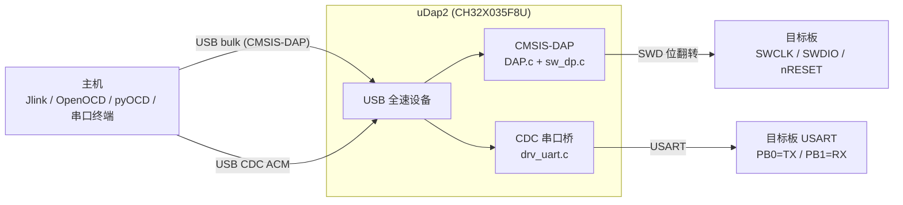

# uDap


uDap 是一个低成本低占面积低外围设计的单芯片 USB 设备同时提供 SWD 调试和一路虚拟串口，或者其他功能。功能可以通过上位机切换或者开启，可以实现多个功能同时工作，大幅度提升开发调试效率

> 设计要求：整个调试器物料成本小于10元，芯片主控引脚数量小于等于48，且要足够大众，产品生命周期长

核心优势如下：
1. 支持 **SWD** 调试协议，用更低的成本实现更高的性能，适配 Cortex-M 系列，STM32、GD32、AT32、CW32、PY32、HK32 等。
2. 集成 **USB2UART** 功能，支持多种波特率，满足大量数据传输和日志打印的需求
3. 满足无调试器也能够烧录固件的功能
4. 提供 **5V/3.3V** 双路电源输出





### uDap-CH32X035F8U6

- 调试器 ①：**CMSIS-DAP**（bulk，WinUSB）——OpenOCD / pyOCD / probe-rs 可直接使用。**固定编入**
- 调试器 ②：**WCH-Link**（RVSWD，`1a86:8010`）——支持 CH32X03X / CH32L10X / CH32V20X /
  CH32V30X / CH58X / CH59X 六个目标族。**可选编译**（`build.ps1 -Wchlink y`，默认不编），
  编入后上电时**按住 PB3**切到另一种调试器模式
- 桥接串口 ①：CDC ACM ↔ 目标板 USART4（PB0=TX / PB1=RX），**不限制波特率**
- 桥接串口 ②（双串口模式）：CDC ACM ↔ USART2（PA2=TX2 / PA3=RX2），独立波特率
- PA2 / PA3 **双用途**：`DTR` + `RTS`（低有效）或 `TX2`/`RX2`，按键**双击**切换、掉电保存
- **串口模式决定 USB 里有几个 CDC**：单串口 + 流控只枚举 1 个 COM 口（USART2 关闭），
  双串口枚举 2 个；切换模式会重新枚举一次
- **COM1 的接收走 DMA**（USART4_RX = DMA1_Channel8，1 KB 环形缓冲）：逐字节 RXNE
  中断从每秒 10 万次降到「每半个缓冲一次」，高波特率下不再因 ISR 延迟触发 ORE
  丢字节。TX（含 COM2 全部方向）仍用中断 —— 实测给 TX 挂 DMA（Ch1 / Ch7）会让
  对应串口卡死，原因未定位。注意 USB IN 侧的总吞吐天花板（≈190~200 KiB/s）与
  DMA 无关，双口同时满速时仍受它限制
- SWD 时钟：请求 **≥6 MHz** 自动切「快路径」，**6 MHz 与更高同速**，推荐就填 6 MHz
- SWD 吞吐（STM32F411 目标，64 KiB 块）：**pyocd 262 写 / 232 读 KiB/s**、
  OpenOCD 149 / 148、probe-rs 155 / 140 —— 见「性能实测」一节
- 串口环回：**2 Mbaud 持续满载零丢字节**（96~98 % 利用率）；分块发送时 6 Mbaud 亦字节无误
- 桥接吞吐天花板：约 **190~200 KiB/s**（≈2 Mbaud），受 USB IN 侧调度限制，与 USB 带宽无关

| 信号 | 引脚 | 说明 |
| --- | --- | --- |
| SWCLK | PA5 | SWD 时钟 |
| SWDIO | PA6 | SWD 双向数据（CFGLR 动态切输入/输出） |
| nRESET | — | 本板未接 MCU（复位走 SWD 的 SYSRESETREQ） |
| DTR / TX2 | PA2 | 流控模式 = DTR（低有效）；双串口模式 = USART2_TX |
| RTS / RX2 | PA3 | 流控模式 = RTS（低有效）；双串口模式 = USART2_RX |
| 桥接串口 1 | PB0 = TX / PB1 = RX | USART4 |
| 模式按键 | PB3 | 上拉输入，按下接地；双击切串口模式，上电按住切调试器模式 |
| DAP 灯 | PB11 | 低电平点亮，CMSIS-DAP 连接时亮 |
| UART 灯 | PB12 | 低电平点亮，亮 = 双串口模式 |
| USB | PC16 = DPDM / PC17 = DP | 固定复用 |

### uDap-CH32V203F8U6

### uDap-CH572

### uDap-CH552G


## 对照测试

本节把「本板 uDAP 以外的第三方 CMSIS-DAP 探针」的 SWD 吞吐测试集中在一处：
测试方法、五块探针的标识、以及**唯一的总表**（按频率 × 块大小 × 调试器排成矩阵）。
各探针不再单独列表，避免与总表重复。

#### 测试对象与接线

| 项目 | 值 |
| --- | --- |
| 目标 | STM32F411CEU6（CPUID `0x410FC241`、DBGMCU IDCODE `0x10006431` → DEV_ID `0x431`、512 KB Flash、128 KB SRAM） |
| 测试区 | 目标 SRAM `0x20000000` 起（与 18.1、18.5 同一地址，便于对比） |
| 接线 | 探针 SWCLK / SWDIO / GND 接目标，目标单独供电 |

#### 测量流程

1. 打开探针会话、`halt` 目标；
2. **整块备份**测试区，测完**逐字写回**并 `resume`，不破坏目标正在跑的程序；
3. 填充模式 `0xA5A50000 | i`（变化的 pattern，能暴露地址线/数据线问题与突发顺序错误）；
4. 每个「频率 × 块大小」组合先预热一次，再正式测 5 次；写、读**各自单独计时**，
   读回**逐字校验**；失败（ACK 错 / 超时 / 数据不符）记 `ok=0` 并继续；
5. 每组取**中位数**（不取平均，避免个别离群值污染）。

#### 参数与工具

| 参数 | 取值 |
| --- | --- |
| 频率 | **1 / 3 / 6 / 9 / 12 / 15 MHz**（6 档；表头「1、3、6…」即 MHz） |
| 块大小 | **1 / 4 / 16 / 64 KiB**（4 档） |
| 重复次数 | 每组合 **5 次**，取中位数 |
| 工具 | **pyocd 0.45.1** 与 **OpenOCD 0.12.0**，同一块探针各扫一遍 |

两个工具都支持在**同一条会话里改频率**（pyocd 用 `probe.set_clock()`，OpenOCD 用
`adapter speed`），所以整轮扫描只连接一次，不会把反复连接的固定开销算进结果。

> 表里的频率是**请求值**，不是实测 SWCLK。探针可能把请求值映射成离散分频，
> 实际时钟与请求值有差距（见下面「注意事项」里的低端反常）。

#### 五块探针的标识

| 探针 | 主机侧名称 | 序列号 | CMSIS-DAP | 备注 |
| --- | --- | --- | --- | --- |
| **本板 uDAP** | `uDAP CMSIS-DAP` | `923CABCDFB83BD7AFFFFFFFF` | 0.1.0 | 本仓库固件；快路径时钟约 6 MHz；无 WebUSB/MSC |
| **FanX Tek DAPLink** | `Arm DAPLink CMSIS-DAP` | `38b30f94aae9ddfa01` | FW 2.1.0，v2(bulk) | SWD+JTAG+SWO-UART；`Packet Count = 4` |
| **CherryUSB CH32V305** | `CherryUSB CMSIS-DAP` | `39D9ABCD` | FW 2.1.1，v2 | 自制板；**pyocd 不可用**（见下） |
| **LuatOS Air32 MINI** | `ABrobot CMSIS-DAP` | `000100011a5a5bb6000000000003f60fa5a5a5a597969908` | FW 2.1.0，v1(HID)+v2 | `Packet Count = 100`；**读快于写**；**吞吐会跳档**（见下） |
| **SLogic 8** | `SIPEED RV CMSIS-DAP` | `012345ABCDEF` | FW 2.1.0，v2 | Sipeed 板，VID:PID 为 `d6e7:3507`（**与其余四块不同**）；`Packet Count = 8` |

> 前四块的 VID:PID 都是 `0d28:0204`，同时插入时**必须**用序列号区分：
> OpenOCD 侧 `-c "adapter serial <id>"`，pyocd 侧 `unique_id`。序列号用 `pyocd list` 查。

#### 总表：OpenOCD（写 / 读，KiB/s，5 次中位数）

| 调试器 | 块大小 | 1 | 3 | 6 | 9 | 12 | 15 |
| --- | --- | ---: | ---: | ---: | ---: | ---: | ---: |
| 本板 uDAP (CH32X035) | 1 KiB | 24 / 21 | 50 / 49 | 143 / 141 | 151 / 143 | 143 / 143 | 151 / 143 |
| 本板 uDAP (CH32X035) | 4 KiB | 24 / 22 | 50 / 50 | 151 / 145 | 152 / 142 | 152 / 143 | 151 / 144 |
| 本板 uDAP (CH32X035) | 16 KiB | 24 / 22 | 51 / 50 | 151 / 145 | 151 / 144 | 154 / 146 | 154 / 146 |
| 本板 uDAP (CH32X035) | 64 KiB | 24 / 22 | 51 / 50 | 151 / 144 | 152 / 144 | 153 / 147 | 153 / 147 |
| FanX Tek DAPLink | 1 KiB | 177 / 179 | 250 / 237 | 278 / 279 | 314 / 307 | 500 / 333 | 500 / 366 |
| FanX Tek DAPLink | 4 KiB | 185 / 197 | 258 / 269 | 318 / 323 | 302 / 313 | 462 / 437 | 456 / 444 |
| FanX Tek DAPLink | 16 KiB | 185 / 193 | 258 / 262 | 315 / 325 | 303 / 304 | 461 / 458 | 464 / 470 |
| FanX Tek DAPLink | 64 KiB | 182 / 183 | 258 / 263 | 307 / 307 | 302 / 303 | 457 / 469 | 458 / 468 |
| CherryUSB CH32V305 | 1 KiB | 107 / 125 | 200 / 200 | 242 / 250 | 333 / 333 | 390 / 390 | 475 / 378 |
| CherryUSB CH32V305 | 4 KiB | 116 / 119 | 195 / 205 | 254 / 269 | 412 / 399 | 426 / 400 | 425 / 400 |
| CherryUSB CH32V305 | 16 KiB | 117 / 120 | 197 / 206 | 261 / 275 | 427 / 398 | 428 / 405 | 450 / 410 |
| CherryUSB CH32V305 | 64 KiB | 117 / 121 | 198 / 206 | 261 / 275 | 426 / 396 | 425 / 400 | 439 / 416 |
| LuatOS Air32 MINI | 1 KiB | 130 / 125 | 200 / 200 | 248 / 250 | 277 / 250 | 250 / 234 | 250 / 250 |
| LuatOS Air32 MINI | 4 KiB | 128 / 128 | 216 / 208 | 241 / 235 | 267 / 267 | 261 / 268 | 267 / 267 |
| LuatOS Air32 MINI | 16 KiB | 130 / 128 | 213 / 207 | 251 / 246 | 276 / 275 | 268 / 265 | 274 / 267 |
| LuatOS Air32 MINI | 64 KiB | 129 / 130 | 215 / 210 | 252 / 245 | 276 / 274 | 268 / 265 | 272 / 269 |
| SLogic 8 (Sipeed) | 1 KiB | 59 / 58 | 105 / 105 | 130 / 129 | 147 / 143 | 169 / 155 | 148 / 151 |
| SLogic 8 (Sipeed) | 4 KiB | 60 / 60 | 108 / 108 | 132 / 131 | 157 / 147 | 166 / 159 | 166 / 160 |
| SLogic 8 (Sipeed) | 16 KiB | 59 / 59 | 110 / 109 | 135 / 131 | 155 / 148 | 166 / 158 | 166 / 159 |
| SLogic 8 (Sipeed) | 64 KiB | 59 / 59 | 110 / 109 | 135 / 131 | 154 / 148 | 167 / 159 | 166 / 159 |

#### 总表：pyocd（写 / 读，KiB/s，5 次中位数）

| 调试器 | 块大小 | 1 | 3 | 6 | 9 | 12 | 15 |
| --- | --- | ---: | ---: | ---: | ---: | ---: | ---: |
| 本板 uDAP (CH32X035) | 1 KiB | 47 / 16 | 105 / 40 | 383 / 170 | 395 / 170 | 393 / 171 | 376 / 173 |
| 本板 uDAP (CH32X035) | 4 KiB | 29 / 21 | 67 / 52 | 281 / 219 | 283 / 219 | 283 / 219 | 282 / 219 |
| 本板 uDAP (CH32X035) | 16 KiB | 27 / 23 | 62 / 56 | 265 / 231 | 265 / 230 | 265 / 231 | 265 / 231 |
| 本板 uDAP (CH32X035) | 64 KiB | 26 / 23 | 60 / 57 | 261 / 234 | 261 / 234 | 261 / 234 | 261 / 234 |
| FanX Tek DAPLink | 1 KiB | 229 / 234 | 333 / 338 | 413 / 400 | 403 / 410 | 678 / 670 | 655 / 677 |
| FanX Tek DAPLink | 4 KiB | 247 / 245 | 375 / 370 | 457 / 448 | 461 / 456 | 835 / 769 | 837 / 774 |
| FanX Tek DAPLink | 16 KiB | 251 / 246 | 389 / 372 | 475 / 452 | 475 / 450 | 881 / 777 | 882 / 779 |
| FanX Tek DAPLink | 64 KiB | 252 / 244 | 391 / 373 | 479 / 451 | 479 / 452 | 893 / 778 | 894 / 781 |
| CherryUSB CH32V305 | 1 KiB | — | — | — | — | — | — |
| CherryUSB CH32V305 | 4 KiB | — | — | — | — | — | — |
| CherryUSB CH32V305 | 16 KiB | — | — | — | — | — | — |
| CherryUSB CH32V305 | 64 KiB | — | — | — | — | — | — |
| LuatOS Air32 MINI | 1 KiB | 166 / 157 | 264 / 283 | 259 / 336 | 273 / 321 | 270 / 326 | 270 / 323 |
| LuatOS Air32 MINI | 4 KiB | 176 / 164 | 287 / 314 | 287 / 362 | 293 / 364 | 296 / 362 | 291 / 352 |
| LuatOS Air32 MINI | 16 KiB | 179 / 163 | 295 / 313 | 296 / 358 | 298 / 362 | 298 / 357 | 298 / 365 |
| LuatOS Air32 MINI | 64 KiB | 179 / 162 | 296 / 313 | 296 / 359 | 297 / 362 | 298 / 359 | 296 / 359 |
| SLogic 8 (Sipeed) | 1 KiB | 66 / 65 | 129 / 126 | 163 / 154 | 190 / 180 | 207 / 194 | 207 / 194 |
| SLogic 8 (Sipeed) | 4 KiB | 68 / 66 | 137 / 131 | 176 / 163 | 207 / 190 | 226 / 207 | 226 / 208 |
| SLogic 8 (Sipeed) | 16 KiB | 69 / 66 | 139 / 131 | 178 / 163 | 210 / 190 | 230 / 208 | 231 / 208 |
| SLogic 8 (Sipeed) | 64 KiB | 69 / 66 | 139 / 131 | 179 / 163 | 211 / 190 | 232 / 208 | 232 / 208 |

> CherryUSB CH32V305 的 pyocd 一栏全为「—」：这块自制探针在 pyocd 下不可用，
> 而且会把探针卡死到需要拔插 USB 才能恢复，见下面「注意事项」。

#### 从总表读出的结论

1. **形状分三类。**
   - **本板 uDAP 是「三级」**：1~3 MHz 走慢路径（64 KiB 写 24→51），**6 MHz 跳约 3 倍**，
     之后 6~15 MHz 完全平坦（151~154）—— 就是 18.1 说的快/慢路径阈值（6 MHz），
     且快路径的实际 SWCLK 由指令数钉死（约 6 MHz），请求再高也不变。
   - **FanX Tek / CH32V305 / Air32 是「台阶式」**：请求频率被映射成离散分频，所以
     吞吐随频率分段跳、跳到台阶之上就持平。FanX 的台阶在 9~12 MHz 之间（OpenOCD
     64 KiB 写 302→457），CH32V305 与 Air32 在 6~9 MHz 之间（OpenOCD 分别 261→426、
     252→276）。**对这类探针，跳到台阶之上再往上填没有收益。**
   - **SLogic 8 是「单调缓升 + 饱和」**：从 59 一路升到 12 MHz 的 167（OpenOCD），
     没有明显台阶，12 MHz 之后持平。低频段它比 uDAP 快得多（1 MHz 59 vs 24）。
2. **本板 uDAP 在五者里最慢，差距集中在两头**：低频段 1 MHz（64 KiB 写）uDAP 24，
   其它 59~182；高频段 6 MHz 及以上 uDAP 151，其它 135~458。低频差是因为慢路径的
   半周期延时太大，高频差是因为快路径被约 6 MHz 的实际时钟钉住。
3. **块大小基本不影响吞吐**：五块探针、两个工具、全频段下 1/4/16/64 KiB 的差异几乎都在
   10% 以内（uDAP 与 SLogic 8 最平，<3%）。**唯一明显的是 pyocd 的小块写**：uDAP 在
   6 MHz 时 1 KiB 写 383 比 64 KiB 写 261 高 **47%**，FanX 与 SLogic 8 也是同方向
   （小块更快）—— 这是主机侧把多个写命令流水化的效果；反过来**小块读更慢**（要等回包）。
   注意这一列对 uDAP 可能偏高，见下面「注意事项」第 1 条。
4. **pyocd 全面高于 OpenOCD**，比值因探针而异：约 1.7~2.0×（同为 64 KiB、6~12 MHz）。
   原因是 OpenOCD 把在飞命令数夹在写死的 `MAX_PENDING_REQUESTS = 3`（`cmsis_dap.c`），
   而 pyocd 不设这个上限。Air32 的 `DAP_PACKET_COUNT = 100` 也改变不了这一点 ——
   限制在主机侧，不在探针侧。
5. **读写关系**：uDAP、FanX、CH32V305、SLogic 8 都是**读 ≤ 写或基本对称**，
   **只有 Air32 是读明显快于写**（pyocd 64 KiB @12 MHz：写 298 / 读 359）。
   要读大块数据时 Air32 在低频段是五者里最快的。

#### 复现命令

```powershell
# 扫一块探针（两个工具都扫；默认 1/3/6/9/12/15 MHz × 1/4/16/64 KiB × 5 次）
python firmware/tools/probe_swd_sweep.py --label "FanX Tek DAPLink" ^
    --probe 38b30f94aae9ddfa01 --tool both --reps 5 ^
    --csv firmware/build/sweep_fanx_tek.csv

# 只跑一个工具 / 自定义频率与块大小
python firmware/tools/probe_swd_sweep.py --tool openocd --freqs 1000,9000,15000 --sizes 1024,65536
```

逐次原始结果写入 `--csv`（默认落在 `firmware/build/`，该目录不入库）。
§18 其余小节各自的复现命令见那一节本身（18.1 / 18.2 / 18.4 / 18.5）。

#### 附：pyocd 的 "at X kB/s" 不可信

pyocd 的烧录日志：

```
Erased 65536 bytes (4 sectors), programmed 51200 bytes (50 pages), identical 0 bytes (0 pages) at 23.67 kB/s
```

该速度 = `program_byte_count / (erase_time + program_time)`（见 `pyocd/flash/loader.py` 的
`_log_performance`）。当写入数据与 Flash 现有一致时，smart_flash 会跳过擦除与编程，
**分母塌掉、分子照旧**，数字虚高数倍。

判据：**出现 `Erased 0 bytes (0 sectors)` 即为跳过烧录，该速度无意义。**

| 50 KiB @12 MHz | 编程耗时 | 速度 |
| --- | --- | --- |
| 真实烧录 | 743 ms | 68.9 KiB/s |
| 跳过烧录 | — | 160.67 kB/s（虚高，实为读回带宽） |

强制真实烧录：加 `-O smart_flash=False`，或每次换一份随机数据。

